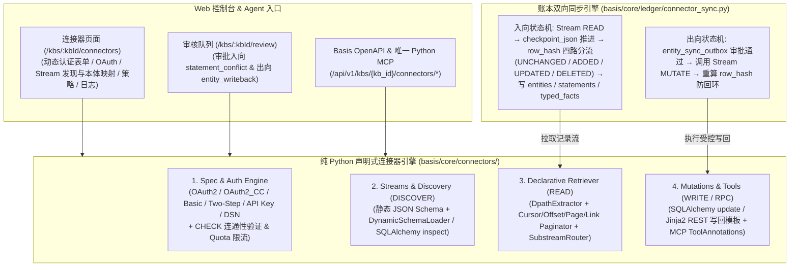

# Helix Foundry 能力借鉴与 Basis 统一架构落点

**Status:** accepted reference（架构决策见 [ADR 0003](0003-lakehouse-datasets.md) 与 [data-model.md §18](../data-model.md)）  
**Date:** 2026-10-18  
**Related:** [ADR 0001 — 证据账本](0001-canonical-knowledge-model.md) · [ADR 0003 — 结构化源与实体双向同步](0003-lakehouse-datasets.md) · [data-model.md §18](../data-model.md) · [features.md §5.16–5.18](../features.md)

## 1. 核心结论：中间完全统一，只扩“两头”，以纯 Python 声明式连接器协议（BOCP）统一所有外部源

对比 [Helix Foundry](https://github.com/helixdb/helix-foundry)（多源连接器、跨源实体对齐、业务对象操作）、同级目录中的 **Nango (`../nango`)**、**Airbyte (`../airbyte`)**、**AnyConnect (`../fellowos/connectors`)** 与 Basis 后，Basis **不搞第二套菜单、不建独立的 Parquet 数据湖、不引入 DuckDB SQL 沙箱，也彻底摒弃跨进程调用 Node.js TS 代码的双栈妥协**。

我们在 Basis 的 **Python FastAPI 单一后端**内直接建立 **`Basis Open Connector Protocol (BOCP)` 纯 Python 声明式连接器引擎（`basis/core/connectors/`）**：
- **认证与连接层（吸收 Nango `providers.yaml` + AnyConnect 认证方言）**：100% 声明式支持 `OAUTH2`（含 PKCE、自定义Envelope解包）、`OAUTH2_CC`（机器凭证）、`BASIC`（账号密码）、`TWO_STEP`（账密登录换 Session Token）、`API_KEY`、`DATABASE_DSN` 与 `CUSTOM`（动态实例域名 `connection_config` + AES-256-GCM 加密密钥）。
- **流发现与同步层（吸收 Airbyte `DeclarativeSource` YAML + Nango `Sync` 状态机）**：统一关系型数据库（`postgres` / `mysql`，由 **SQLAlchemy 2.0** 驱动）与 1,000+ SaaS 应用（由声明式 `HttpRequester` + `DpathExtractor` + 4 种标准 `Paginator` + `DynamicSchemaLoader` 驱动）。
- **受控写回与工具层（吸收 Nango `Action/Tool` + Hightouch 写回模板 + MCP `ToolAnnotations`）**：不管是数据库表还是 SaaS 对象，入向全部走 **`Stream READ` → `source_table_mappings`（含 `checkpoint_json` 水位线与 `row_hash` 去重）→ 进账本**，出向全部走 **`Review` → `entity_sync_outbox` → `Stream MUTATE` 写回**：

```mermaid
flowchart LR
  subgraph Inbound["1. 入向：数据源接入"]
    DOC["文档 PDF/MD\n(/kbs/:kbId/sources)"] -->|分块 + NER/LLM 抽取| LEDGER
    CONN["统一声明式连接器 (kind = 'connector')\n• 关系库 Adapter (postgres / mysql — SQLAlchemy 2.0)\n• 1,000+ SaaS Declarative Streams (Airbyte + Nango 融合)"] -->|执行 Stream READ (自动分页/增量游标)\n+ 同一套 source_table_mappings| LEDGER
  end

  subgraph Core["2. 统一核心层（Basis 本体服务与账本 — 100% 纯 Python）"]
    LEDGER[(证据账本\nEntities + Statements + TypedFacts)]
    ONT[本体服务与推理\nOntology / SHACL / Reasoner]
    GRAPH[图谱与检索\nGraph / Search]
    REV[审核与决策\nReview / Decisions]
    ONT --- LEDGER
    LEDGER --> GRAPH
    LEDGER <--> REV
  end

  subgraph Outbound["3. 出向：统一写回与动作执行 (Mutations & Tools)"]
    REV -->|批准 entity_sync_outbox| EXEC["统一执行 Stream MUTATE\n(SQLAlchemy update 或 Jinja2 REST 写回)"] --> CONN
  end
```

---

## 2. 菜单设计：在「数据与抽取」下新增独立的「连接器」菜单

**为什么不塞进「资料 (`sources`)」页？**
- 现有 `资料` 页（`/kbs/:kbId/sources`）面向的是**非结构化文档**（「添加文档」弹窗中的上传文件、粘贴文本、从 URL 获取）。
- 而 **Basis Connector（数据库 + AnyConnect 1,390+ SaaS）** 面向的是**外部业务系统连接、OAuth2 凭据、表/对象到本体的双向映射、10,000+ Actions 与调用日志**，与“文档资料”并不是一回事。

因此，删掉 `资料` 页原有的连接器弹窗与按钮，仅在「添加文档」弹窗保留第 3 个 Tab（`从 URL 获取`），并在左侧栏 **`数据与抽取`（`KB_NAV_BY_ZONE.knowledge`）** 下直接新增独立的 **`连接器`（`/kbs/:kbId/connectors`）** 菜单项：

### 2.1 左侧栏 `数据与抽取` 菜单结构（`web/src/lib/nav-config.ts`）

| 菜单项 | 路由路径 | 定位与职责 |
| --- | --- | --- |
| **资料** (`sources`) | `/kbs/:kbId/sources` | **非结构化文档入口**：上传文件、粘贴文本、从 URL 获取文档，产出 `documents` 与 `chunks` |
| **连接器** (`connectors`，**新增**) | `/kbs/:kbId/connectors` | **结构化数据库与 1,390+ SaaS 统一入口**：承接 AnyConnect 全部功能与表/Action 本体映射 |
| **处理任务** (`processing`) | `/kbs/:kbId/processing` | 文档切分/抽取任务队列与后台同步 Job 状态 |
| **实体账本** (`entities`) | `/kbs/:kbId/entities` | 统一查看文档抽取与连接器同步进来的所有实体，支持外部字段内联修改与触发写回 |
| **实体解析** (`entity-resolution`) | `/kbs/:kbId/entity-resolution` | 跨文档、跨数据库/SaaS 的同名/同键实体对齐与合并 |
| **决策记录** (`decisions`) | `/kbs/:kbId/decisions` | 审计所有人工与 Agent 的审批决策（`agent_decisions`） |
| **审核队列** (`review`) | `/kbs/:kbId/review` | 统一审批文档抽取冲突、入向同步冲突（`statement_conflict`）与出向业务系统写回（`entity_writeback`） |

### 2.2 新增「连接器 (`/kbs/:kbId/connectors`)」页面内部的 4 个 Tab

将 AnyConnect（`fellowos/connectors/packages/web`）的页面内聚在 `/kbs/:kbId/connectors`（`web/src/pages/kb/connectors.tsx`）中，不再分散到其他页面：

| `/kbs/:kbId/connectors` 内部 Tab | 对应原 AnyConnect 组件 | 核心功能 |
| --- | --- | --- |
| **Tab 1：连接与服务目录 (`Connections & Providers`)** | 动态认证表单与目录 | 顶部展示当前 KB 已激活的连接（`postgres`、`mysql`、`airtable`、`hubspot` 等）；下方浏览/搜索 1,000+ Providers，根据 `AuthSpec` 自动渲染 OAuth2 一键授权、OAuth2_CC、账号密码（Basic/Two-Step）、API Key、数据库 DSN 或自定义实例域名表单，保存时自动执行 `CHECK` 验证 |
| **Tab 2：本体映射与同步 (`Ontology Mappings`)** | Stream → 本体映射向导 | 配置 `source_table_mappings`：通过 `DISCOVER` 动态探测并选择已连接的数据库表或 SaaS `Stream`，指定主键列、增量游标列、名称列，将字段映射为本体类（`target_class_uri`）与谓词（`predicate_uri`），设置入向/双向写回模式并一键触发同步 |
| **Tab 3：动作目录与策略 (`Actions & Policy`)** | `actions.tsx` + `access.tsx` | 搜索/调试 10,000+ Actions（查看入参/出参 JSON Schema 与 Agent Markdown 指南），配置当前 KB 的 `kb_connector_policies`（允许/禁止的 Providers 与 Actions 白名单，落地 `F-OPS-02`） |
| **Tab 4：运行日志 (`Runs`)** | `runs.tsx` | 查看 `kb_connector_runs`：每次入向拉取与出向 Action 执行的脱敏输入/输出快照、耗时、状态码与报错详情 |

---

## 3. 从 Helix Foundry 借鉴什么、砍掉什么

### 3.1 直接借鉴并融入统一账本的能力

| Foundry 能力 | 在 Basis 统一架构中的落点 | 对应 `F-*` |
| --- | --- | --- |
| **连接器测试连接与表/字段发现**（SQLAlchemy `inspect` / SaaS Schema） | 在 `连接器 (/kbs/:kbId/connectors)` 中探测表或对象 Schema、主键、外键，自动生成「字段 → 本体属性」映射草稿 | `F-LAKE-01/02`、`F-OPS-04` |
| **跨源同一实体对齐**（如同一客户在 DB 和 Stripe 的键匹配） | 写入 `entity_external_refs`，通过外部主键（`external_key`）或邮箱等对齐列合并到同一个 Basis `entity_id`（必要时进 `Review` 实体合并） | `F-IDN`、`F-OPS-04` |
| **定时快照与增量比对**（基于 `row_hash` 判断哪些行变了） | 同步作业仅对 `row_hash` 变化的行 Supersede 旧 `statements`，避免全表重写账本 | `F-OPS-05` |
| **对象级编辑与前后预览（Before / After Preview）** | 修改绑定了业务库的实体属性或触发 Action 时，在 `Review` 展示变更前后对比，批准后写回外部库 | `F-OPS-01`、`F-GOV` |
| **连接器凭据加密与安全 URL 校验**（防云元数据 SSRF） | 复用平台加密设置存数据库密码；连接器复用安全 URL/Host 校验 | `F-ACC`、`F-SRC` |

### 3.2 明确砍掉（不迁移）的设计

| Foundry 做法 | 为什么 Basis 不需要 |
| --- | --- |
| **独立的 Parquet 数据集目录 + DuckDB Executor 容器** | 业务实体已直接映射进 Basis 账本（SQLite/Postgres），查询统一走实体/图谱/SPARQL，无需再维护一套 OLAP 数仓 |
| **Home BI 仪表盘与自由 SQL 问数（Analyst）** | Basis 是企业知识与语义底座，不是 BI 报表工具；Agent 统一通过 MCP 查实体与图 |
| **HelixDB 存储与无账号单机模型** | Basis 已有完善的组织租户（ADR 0002）、KB 角色权限与证据账本 |

---

## 4. 双向同步（实体 ↔ 业务数据库）核心机制与账本对齐

> **完整 DDL 与 JSON Schema 见 [data-model.md §18](../data-model.md)。** 开发实现时必须遵守以下与现有 `0002_knowledge_ledger.sql` 及 `projector.py` 对齐的硬性约束：

### 4.1 账本表与图投影对齐（避免踩坑）
1. **禁止向 `statement_evidence` 插入无文档的记录**：
   - `0002_knowledge_ledger.sql` 中 `statement_evidence.chunk_id` 是 `NOT NULL REFERENCES chunks(id)`。结构化数据库行没有文档分块（`chunk_id`），因此**绝不写入 `statement_evidence`**。
2. **标准写入方式（`statements` + `typed_facts`）**：
   - 每个映射列写入一条 `statements`（`proposed_by = 'connector'`，`status = 'confirmed'`，`surface_phrase = column_spec.surface_phrase`）。`KnowledgeStore.list_statements_for_projection`（`access/projection` + `persistence/projection_reads`）使用 `LEFT JOIN statement_evidence`，因此无 `statement_evidence` 仍能正常投影。
   - 若该列配置了本体 `predicate_uri`，同时写入 `typed_facts`（`from_statement_id = statement.id`，`import_provenance_json` 记录 `{"kind": "structured_source", "source_id": ..., "mapping_id": ..., "external_ref_id": ..., "external_table": ..., "external_pk": ..., "column": ...}`）。
   - `projector.py:rebuild_graph_from_ledger` 会自动去重同一三元组的 open statement 与 typed fact，将实体属性/外键关系直接投影到 `ContextGraph`。
3. **决策外键表名**：
   - `entity_sync_outbox.decision_id` 外键必须指向 **`agent_decisions(id)`**（`0002_knowledge_ledger.sql` 真实表名），而非 `decisions(id)`。
4. **实体删除级联（`basis/core/ledger/entity_delete.py`）**：
   - 删除实体时，必须在 `entity_delete.py` 中先清理 `entity_sync_outbox`、`entity_external_refs` 以及 `subject_type = 'entity_sync_outbox'` 的 `review_items`。

### 4.2 入向同步事务（业务库 → Basis 实体）
1. **拉取与比对**：连接器按 `source_table_mappings` 拉取目标表（受 `max_rows` 保护，默认 `10000`），仅提取 `label_column` 与 `column_mappings_json` 中的列，按 `json.dumps(..., sort_keys=True, separators=(",", ":"))` 计算 SHA-256 `row_hash` 并与 `entity_external_refs.row_hash` 对比。
2. **定位或创建实体**：
   - 按 `(kb_id, source_id, external_table, external_pk)` 查找 `entity_external_refs`；
   - 若不存在，先按对齐规则（如 `external_key = "{source_id}:{external_table}:{external_pk}"` 或唯一业务键）查找或创建 `entities`（`canonical_label = row[label_column]`）并写入 `rdf:type = target_class_uri` 的 `typed_facts`。
3. **增量更新与冲突保护**：
   - **无冲突更新**：若某列值变化，且当前生效的同名 `surface_phrase` 陈述为 `proposed_by = 'connector'`，在同一事务内将旧 `statements` / `typed_facts` 设为 `invalidated_at = now`（并设置新行的 `supersedes_id`）。
   - **本地修改冲突保护**：若该 `(subject_id, surface_phrase)` 存在 `proposed_by IN ('user', 'agent')` 的有效陈述且值与上游不同，保留二者并调用 `scan_statement_conflicts(knowledge, kb_id)` 生成 `kind = 'statement_conflict'` 审核项。

### 4.3 出向同步事务（Basis 实体 → 业务库写回）
1. **发起变更**：用户在实体面板编辑了绑定外部可写列（`writable = true`）的属性，或 Agent 调用写回接口。
2. **治理闸口（Outbox + Review）**：
   - 写入 `entity_sync_outbox`（`status = 'pending_review'`，`patch_json` 记录 `{external_table, primary_key_column, external_pk, changes: {col: {old, new, predicate_uri, statement_id}}}`）。
   - 若 `writeback_mode = 'review'`，同时写入 `review_items`（`kind = 'entity_writeback'`，`subject_type = 'entity_sync_outbox'`，`subject_id = outbox.id`）。
   - 若 `writeback_mode = 'direct'`（且操作者具备 `kb.write` + `F-OPS-02` 权限），直接置 `status = 'queued'`。
3. **执行写回与防回环**：
   - 审核通过（`POST /api/v1/kbs/{kb_id}/review/{review_id}/decide`）后，记录 `agent_decisions`，将 outbox 置为 `queued` 并入队后台作业（`jobs.kind = 'entity_writeback'`）。
   - 连接器**严禁手写 SQL 字符串拼接**，必须使用 **SQLAlchemy 2.0 Core**（`sqlalchemy.Table(..., autoload_with=engine)` + `sqlalchemy.update(table).where(table.c[pk_col] == pk_val).values(**changes)`）执行方言安全的参数化单行 `UPDATE`。
   - 写回成功后，立即重算并更新 `entity_external_refs.row_hash` 与 `last_synced_at`（**消除下一轮定时拉取的回环冲突**），将 `entity_sync_outbox.status` 置为 `synced`。
   - 写回失败则置 `status = 'failed'`，记录 `error_code` / `error_detail_json` 并触发 `F-ALT` 告警。

---

## 5. REST API 与 MCP 接口契约（开发规范）

所有新增 HTTP 接口挂在现有 `/api/v1/kbs/{kb_id}/...` 路由下，遵循 `basis/integration/openapi_v1_export.py` 规范（每个 handler 必须包含 docstring，同步运行 `scripts/generate-openapi-v1.py` 更新 `openapi/basis-v1.json` 与前端 `schema.d.ts`）。

### 5.1 数据源、连接与流映射接口（`kb_connectors.py` / `kb_sources.py`）

| 方法与路径 | `operationId` 建议 | 权限 | 入参 / 返回摘要 |
| --- | --- | --- | --- |
| `POST /api/v1/kbs/{kb_id}/sources/test-connection` | `kbSourcesTestConnection` | `kb.write` | 入参：`{kind: "connector", provider: "postgres" \| "airtable" \| ..., auth_type: "...", connection_config: {...}, credentials: {...}}`；调用 BOCP `CHECK` 原语验证连接、SSRF 策略并提取 `{account_id, display_name, granted_scopes}` |
| `GET /api/v1/kbs/{kb_id}/sources/{source_id}/schema` | `kbSourcesIntrospectSchema` | `kb.read` | 调用 BOCP `DISCOVER` 原语（关系库走 `sqlalchemy.inspect(engine)`，SaaS 走静态 Stream Schema 或 `DynamicSchemaLoader`）返回可用 `streams`、主键、增量游标列、字段类型与外键：`{streams: [{stream_name, external_table, primary_key, cursor_column, columns: [{name, data_type, nullable, fk_target_table}]}]}` |
| `GET /api/v1/kbs/{kb_id}/sources/{source_id}/mappings` | `kbSourceMappingsList` | `kb.read` | 返回该数据源下的 `source_table_mappings` 列表 |
| `PUT /api/v1/kbs/{kb_id}/sources/{source_id}/mappings` | `kbSourceMappingsUpsert` | `kb.write` | 入参：`{stream_name, external_table, stream_params, primary_key_column, cursor_column, label_column, target_class_uri, column_mappings, sync_mode, track_deletes, sync_direction, writeback_mode, max_rows}`；创建或更新映射配置 |
| `POST /api/v1/kbs/{kb_id}/sources/{source_id}/sync` | `kbSourcesSync`（复用现有） | `kb.write` | 复用现有触发端点：当 `source.kind == 'connector'` 时，调用 BOCP `runtime.read_stream()` 自动翻页拉取记录、更新 `checkpoint_json`、比对 `row_hash` 并写入账本与图投影，返回 `{imported_rows, updated_entities, unchanged_rows, deleted_rows, conflicts_created}` |

### 5.2 实体外部引用与写回接口（扩展 `kb_entities.py` / `kb_review.py`）

| 方法与路径 | `operationId` 建议 | 权限 | 入参 / 返回摘要 |
| --- | --- | --- | --- |
| `GET /api/v1/kbs/{kb_id}/entities/{entity_id}/external-refs` | `kbEntityExternalRefsList` | `kb.read` | 返回该实体绑定的 `entity_external_refs` 及未完成的 `entity_sync_outbox` 记录 |
| `POST /api/v1/kbs/{kb_id}/entities/{entity_id}/writeback` | `kbEntityWritebackPropose` | `kb.write` | 入参：`{external_ref_id, changes: {column: new_value}, note?: string}`；根据 `writeback_mode` 创建 `pending_review`（含 `review_item_id`）或 `queued` outbox 记录 |
| `POST /api/v1/kbs/{kb_id}/review/{item_id}/decide` | 复用现有决策端点 | `kb.review` | 在现有 handler 中新增对 `kind == 'entity_writeback'` 的分支：若 `decision == 'approve'`，将关联 `entity_sync_outbox` 置为 `queued` 并调用 BOCP `runtime.execute_mutation()` 写回；若 `reject`，置为 `rejected` 并回滚/作废待定 statement |

### 5.3 统一 MCP 服务入口（对外仅暴露 Python `basis-kb-mcp` 一个服务）
- **100% 纯 Python 单一进程**：Agent 侧只连接 Basis Python 的**唯一 MCP 服务（`basis/integration/registry.py`）**，不存在任何跨语言 Node.js MCP 或内部 HTTP 转发。
- **读路径（13 个现有 KB 工具）**：`kb_search`、`kb_entity_get`、`kb_graph_neighbors`、`kb_sparql_query` 等直接读取账本中的实体与属性。
- **连接器与受控动作路径（`basis/integration/ops_connectors.py`）**：
  - 在 `basis/integration/registry.py` 中注册连接器与动作工具：`list_connections`、`search_connector_tools`、`get_connector_tool_guide`、`execute_connector_tool`、`kb_entity_propose_writeback`。
  - 根据 BOCP Manifest 中的 **MCP `ToolAnnotations`**（`readOnlyHint`、`destructiveHint`、`idempotentHint`）与 `kb_connector_policies`：
    - `readOnlyHint: true` 的查询动作可由 Agent 直接执行；
    - `readOnlyHint: false` 的写操作与实体属性变更默认拦截并进入 `entity_sync_outbox` + `Review` 审批队列。

---

## 6. 开源主流框架选型与四阶段实施计划（禁止重复造轮子）

### 6.1 核心技术栈：100% 复用 Python / Web 主流开源框架

开发实现时**严禁手写 SQL 拼接器、严禁手写 `information_schema` 方言查询、严禁手写 `isinstance` 字典校验、严禁维护双语言运行时**。直接使用成熟开源库：

| 子系统能力 | 采用的 Python / Web 开源库 | 具体用法与禁止造轮子红线 |
| --- | --- | --- |
| **数据库表/主键/外键自动探测** | **SQLAlchemy 2.0 Reflection** (`sqlalchemy>=2.0` + `psycopg[binary,pool]>=3.2`) | 使用 `sqlalchemy.inspect(engine)` 的 `get_table_names()`、`get_pk_constraint()`、`get_columns()`、`get_foreign_keys()`。**禁止**手写针对特定数据库的 `SELECT * FROM information_schema...`。 |
| **安全分批读取与参数化单行写回** | **SQLAlchemy 2.0 Core** (`sqlalchemy.Table`, `select`, `update`) | 使用 `Table(name, metadata, autoload_with=engine)` 构建增量/游标 `select(table)` 与 `update(table).where(table.c[pk] == external_pk).values(**changes)`。**禁止**字符串拼接 SQL。 |
| **全模式认证与自动续期** | **`authlib>=1.3.2`** (`AsyncOAuth2Client`) + **`cryptography`** (`AESGCM`) | 统一驱动 `OAUTH2`（含 PKCE、自定义 Envelope 解包）、`OAUTH2_CC`（机器凭证）、`BASIC`（账号密码）、`TWO_STEP`（账密登录换 Session Token）、`API_KEY`、`DATABASE_DSN` 与 `CUSTOM`。 |
| **HTTP 请求、限流退避与防 SSRF** | **`httpx`** + **`tenacity`** + **`ipaddress`** | 自定义 `httpx` Transport 实现 DNS 解析后的私网/Link-local/云元数据 IP 拦截，并根据响应头（`Retry-After` / `X-RateLimit-Remaining`）自动退避重试。 |
| **声明式 JSON 提取与请求模板** | **`dpath`** + **`jinja2`** (`SandboxedEnvironment`) | 原生解析 Airbyte 风格 `manifest.yaml` 中的 `DpathExtractor`、4 种标准分页器（`cursor` / `offset` / `page` / `link`）、`SubstreamPartitionRouter` 以及写回请求模板。 |
| **Manifest 与契约校验** | **Pydantic v2** (`pydantic>=2`) + **FastAPI** | `ConnectorManifest`（四大原语）与 `data-model.md §18.4` 中的 4 个 JSON 结构全部定义为 `pydantic.BaseModel`。 |
| **前端类型、表单与状态管理** | **`openapi-typescript` + `openapi-fetch` + `react-hook-form` + `zod` + `@tanstack/react-query`** | 后端改完 Pydantic 模型后运行 `npm run gen:openapi-types` 自动生成前端 TS 类型；连接表单根据 `AuthSpec` 动态渲染。 |

### 6.2 目标模块与文件布局

```text
basis/
├── ops/db/migrations/
│   └── 0011_entity_external_sync.sql      # 7 张核心表（连接/OAuth/策略/运行日志 + 映射/外部主键/写回Outbox）等有序 SQL
├── domain/
│   ├── connectors/                        # 【新增】纯 Python 声明式连接器运行时 (BOCP Engine)
│   │   ├── manifest_schema.py             # Pydantic v2 定义 BOCP Manifest 四大原语契约 (Auth/Stream/Sync/Mutation)
│   │   ├── catalog.py                     # 加载内置 manifests/*.yaml（由 Nango + Airbyte + AnyConnect 合并生成）
│   │   ├── auth_engine.py                 # 统一认证引擎：OAuth2(authlib)、OAUTH2_CC、BASIC、TWO_STEP、API_KEY、DSN
│   │   ├── guarded_http.py                # httpx Transport 层：SSRF 内网/元数据拦截 + Quota/Rate-Limit 自动退避
│   │   ├── sql_adapter.py                 # SQLAlchemy 2.0 适配器：关系库 DISCOVER / READ / MUTATE
│   │   ├── rest_declarative_adapter.py    # 声明式 REST 适配器：解析 Airbyte 风格 Retriever/Paginator/Dpath/Jinja2
│   │   └── runtime.py                     # 统一入口：check_connection / discover_streams / read_stream / execute_mutation
│   └── kb/
│       ├── structured_models.py           # Pydantic v2 定义映射、溯源、Outbox JSON 契约
│       └── connector_sync.py              # 账本桥接引擎：uuid5 + row_hash 比对 + 写 entities/statements + Outbox 写回
├── transport/http/routes/v1/
│   └── kb_connectors.py                   # /api/v1/kbs/{kb_id}/connectors/* 统一 REST 接口
└── integration/
    └── ops_connectors.py                  # 挂载到 basis-kb-mcp 的连接器发现与受控执行工具

scripts/
└── build_connector_manifests.py           # 从同级 ../nango、../airbyte、../connectors 提取合成标准 BOCP YAML 目录

web/src/
├── pages/kb/connectors.tsx                # 左侧栏独立「连接器」分区 (/kbs/:kbId/connectors/{catalog,mappings,policy,runs})
├── pages/admin-connectors.tsx             # 平台管理侧栏 → /admin/connectors（Provider 双层 allowlist）
└── components/app/kb/connectors/          # 连接配置弹窗(动态表单/OAuth)、Stream→本体映射向导、Outbox 审核对比
```

### 6.3 四阶段实施计划与验收标准（DoD）

#### Phase 1：数据库底座与 BOCP 协议契约 + 开源资产合成脚本（预计 2~3 天）
- **落地 `0011_entity_external_sync.sql`（7 张表）**：4 张连接器治理与凭据表（`kb_connector_policies`、`kb_connections`、`kb_oauth_configs`、`kb_connector_runs`）+ 3 张账本双向同步表（`source_table_mappings`、`entity_external_refs`、`entity_sync_outbox`）。
- **定义 BOCP 协议 Schema (`basis/core/connectors/manifest_schema.py`)**：用 Pydantic v2 定义 `AuthSpec`（17 种认证模式 + `check` 校验端点）、`StreamSpec`（静态 Schema 或 `DynamicSchemaLoader`）、`RetrieverSpec`（`DpathExtractor` + 4 种标准 `Paginator` + 父子流路由）、`MutationSpec` & `ToolSpec`。
- **编写跨仓资产合成脚本 (`scripts/build_connector_manifests.py`)**：从同级目录 `../nango/packages/providers/providers.yaml`（1,000+ Provider 认证模板）、`../airbyte/airbyte-integrations/connectors/*/manifest.yaml`（516 个声明式流配置）与 `../fellowos/connectors/catalog/apps/`（图标与动作元数据）自动合成标准 BOCP YAML 目录。
- **DoD**：`uv run pytest` 通过迁移测试；Pydantic 100% 加载并校验合成后的连接器 Manifest 目录。

#### Phase 2：纯 Python 连接与认证引擎 + 声明式流读取/动态发现引擎（预计 4~5 天）
- **统一认证与连接管理 (`auth_engine.py` & `guarded_http.py`)**：实现 `AES-256-GCM` 凭据加解密；基于 `authlib` 支持 `OAUTH2`、`OAUTH2_CC`；基于 `httpx` 支持 `BASIC`（账号密码）、`TWO_STEP`（两步登录换 Token）、`API_KEY`、`CUSTOM`（含动态域名模板 `{{config.domain}}`）与 `CHECK` 连通性自检（自动提取外部 `account_id` / `display_name`）。
- **双内核声明式流执行器 (`sql_adapter.py` + `rest_declarative_adapter.py`)**：
  - 关系库内核（SQLAlchemy 2.0）：实现 `DISCOVER`（`inspect(engine)` 探表、列、主外键）、`READ`（按主键/游标分批读取）、`MUTATE`（参数化 `update()`）。
  - REST 声明式内核：实现 `DynamicSchemaLoader`（动态探测 Airtable/Notion/飞书自定义列）、4 种自动分页器（`cursor` / `offset` / `page` / `link`）、`SubstreamPartitionRouter`、`DpathExtractor` 与 Jinja2 写回请求渲染。
- **DoD**：单测覆盖关系库与典型 REST SaaS 的 `CHECK`、动态 `DISCOVER`、多页自动翻页 `READ`、增量 `cursor` 推进与 SSRF 拦截。

#### Phase 3：证据账本双向同步引擎（Inbound Sync ↔ Review ↔ Outbound Write-back）（预计 4~5 天）
- **入向四路同步状态机 (`basis/core/ledger/connector_sync.py`)**：计算 `row_hash`（SHA-256），自动分流处理 `UNCHANGED`（跳过）、`ADDED`（建实体与 `statements` + `typed_facts`）、`UPDATED`（未覆写则 supersede，存在 `user`/`agent` 覆写则生成 `statement_conflict` 审核项）、`DELETED`（`track_deletes` 软撤销），持久化 `checkpoint_json` 并刷新图投影。
- **出向写回与防回环状态机 (`entity_sync_outbox` + `conflict_review.py`)**：修改绑定属性生成 `pending_review` outbox 记录与 `review_items`；审批通过后写入 `agent_decisions`，调用 `runtime.execute_mutation()` 写回外部系统，**立即重算并更新 `entity_external_refs.row_hash`**（彻底杜绝下一轮定时拉取产生假冲突回环）；在 `entity_delete.py` 补齐级联清理。
- **DoD**：端到端测试跑通「首次拉取建图 → 二次拉取幂等跳过 → 本地修改属性产生冲突审核 → Outbox 审批写回 → 写回后更新 `row_hash` 防回环」。

#### Phase 4：OpenAPI / MCP 暴露与前端独立「连接器 (`/kbs/:kbId/connectors`)」控制台（预计 4~5 天）
- **REST API 与 MCP 导出 (`kb_connectors.py` + `ops_connectors.py`)**：暴露连接器目录、凭据管理、OAuth 回调、`discover`、`mappings`、`sync`、`writeback` 接口，同步生成 OpenAPI 快照与前端 TS 类型；在 `basis-kb-mcp` 注册连接器工具。
- **前端「连接器」独立工作台 (`web/src/pages/kb/connectors.tsx`)**：左侧栏 **连接器** 分区四路由（目录 / 映射 / 策略 / 运行日志）；平台 **`/admin/connectors`** 管理 Provider allowlist；映射支持 `poll_interval_minutes` 与 `BASIS_HTTP_POLL_TICK_SECONDS` 后台入向调度；`review.tsx` 写回 `Before → After` Diff；`npm run audit:locale` + `npm run typecheck`。

---

## 7. Basis Open Connector Protocol (BOCP) 四大领域原语规范

通过深度对比同级目录中的 **Nango (`../nango`)**、**Airbyte (`../airbyte`)** 与 **AnyConnect (`../fellowos/connectors`)**，BOCP 将每个连接器定义为由 **4 个正交领域原语** 组成的声明式 Manifest（彻底取代手写 TS 执行器）：



### 7.1 四大领域原语与三大开源项目的取长补短映射表

| BOCP 原语 | 吸收的开源设计来源 | 核心能力与解决的痛点 |
| --- | --- | --- |
| **原语 1：`auth` & `requester`**<br>（全模式声明式认证与限流守卫） | **Nango `providers.yaml`**（17 种 `auth_mode` + `connection_config`）<br>+ **AnyConnect `OAuth2AuthDefinition`**（非标 token envelope 解包）<br>+ **Airbyte `TokenQuota`**（响应头自适应限流） | 零代码覆盖 `OAUTH2`、`OAUTH2_CC`、`BASIC`（账号密码）、`TWO_STEP`（账密登录换 Token）、`API_KEY`、`DATABASE_DSN`、`CUSTOM`；保存时通过声明式 `check` 端点自动校验并提取账号画像；内置 SSRF 私网拦截与配额退避。 |
| **原语 2：`streams` & `discovery`**<br>（业务对象流与动态 Schema 发现） | **Airbyte `DISCOVER` 原语 + `DynamicSchemaLoader` + `TypesMap`**<br>+ **SQLAlchemy 2.0 `inspect(engine)`** | 彻底解决 AnyConnect 静态 JSON Schema 对自定义表（Postgres/MySQL、Airtable、Notion、飞书多维表格、CRM 自定义字段）只能写 `Record<string, unknown>` 的痛点；支持级联枚举容器（如 `Base -> Table`）并动态拉取真实字段、主键与外键。 |
| **原语 3：`retriever` & `sync`**<br>（声明式提取、自动翻页与增量水位线） | **Airbyte `SimpleRetriever` + `DefaultPaginator` + `SubstreamPartitionRouter`**<br>+ **Nango `paginate.service.ts` + `RecordsStore` (`uuid5` + `checkpoint` + `track_deletes`)** | 无需为每个 Provider 手写翻页循环，YAML 声明即可自动完成 `cursor` / `offset` / `page` / `link` 翻页、父子流遍历（如先拉 `repos` 再拉 `issues`）、增量游标推进与软删除检测。 |
| **原语 4：`mutations` & `tools`**<br>（出向受控写回与 Agent 工具） | **Nango `Action / Tool`**<br>+ **Hightouch Reverse-ETL 写回模板**<br>+ **MCP `ToolAnnotations`** | 补齐 Airbyte 只有入向没有出向写回的短板：每个 `Stream` 直接绑定 `create` / `update` / `upsert` / `delete` 写回模板（供 `entity_sync_outbox` 审批后调用）；独立 RPC 动作携带 `readOnlyHint` / `destructiveHint` 供策略引擎自动分级拦截。 |

### 7.2 全连接方式支持矩阵（全面覆盖并超越 AnyConnect）

| 连接/认证方式 | `auth_type` 枚举值 | 声明式配置要素（零手写代码） | Python 执行器实现 |
| --- | --- | --- | --- |
| **OAuth 2.0 授权码（含 PKCE & 非标方言）** | `oauth2` | `authorization_url`、`token_url`、`scopes`、`scope_separator`、`pkce`、`token_response_envelope` | `authlib` `AsyncOAuth2Client` + Envelope 解包 + 过期自动 Refresh |
| **OAuth 2.0 客户端凭证（M2M 自建应用）** | `oauth2_cc` | `token_url`、`token_params: {grant_type: client_credentials}`（如飞书/企微 `app_id` + `app_secret`） | `authlib` `client_credentials` 自动获取与静默续期 |
| **账号密码（HTTP Basic Auth）** | `basic` | `credentials: [username, password]` | `httpx.BasicAuth` 自动编码注入 |
| **两步账密登录换 Session Token** | `two_step` | `token_url`、`body_format: form\|json`、`token_params` 模板、`token_response.token` 提取路径 | 声明式登录获取 Session Token 并按 `token_expires_in_ms` 自动缓存续期 |
| **API Key / Personal Access Token** | `api_key` | `headers` 或 `query` 模板（如 `Authorization: Bearer ${apiKey}`），支持 `extra_fields` | 模板变量安全注入 Header / Query |
| **关系型数据库直连** | `database_dsn` | `host`、`port`、`database`、`username`、`password`、`ssl_mode`（或 DSN URI） | `SQLAlchemy 2.0` `URL.create()` + `pool_pre_ping=True` 连接池 |
| **多字段自定义凭据 & 私有实例域名** | `custom` | `connection_config`（如 `subdomain`、`region`、`instance_url`）+ 加密 `credentials` | Jinja2 沙箱渲染 `base_url` + `guarded_http.py` SSRF 校验 |

### 7.3 Basis Connector 统一对外 REST API 契约（挂在 `/api/v1/kbs/{kb_id}/connectors/*`）

将所有连接器目录、凭据、动态 Schema 发现、流映射与动作执行接口统一收口到 Basis 知识库作用域（自动继承 Basis 会话鉴权与 `kb.read` / `kb.write` RBAC）：

| 方法与路径 | `operationId` 建议 | 说明 |
| --- | --- | --- |
| `GET /api/v1/kbs/{kb_id}/connectors/providers` | `kbConnectorsProvidersList` | 列出当前 KB 可用的连接器目录（含认证方式 `auth`、连接参数 `connection_config`、可读 entities、可写 mutations 与 procedures） |
| `GET /api/v1/kbs/{kb_id}/connectors/connections` | `kbConnectorsConnectionsList` | 列出当前 KB 下已配置的数据库与 SaaS 连接状态（脱敏，含 `account_profile_json`） |
| `PUT /api/v1/kbs/{kb_id}/connectors/connections/{service}` | `kbConnectorsConnectionUpsert` | 保存并执行 `CHECK` 验证当前 KB 的数据库连接（DSN）或 SaaS 凭据（API Key / 账号密码 / Custom，支持 `?connection_name=default`） |
| `DELETE /api/v1/kbs/{kb_id}/connectors/connections/{service}` | `kbConnectorsConnectionDelete` | 删除指定连接凭据 |
| `POST /api/v1/kbs/{kb_id}/connectors/oauth/{service}/authorize` | `kbConnectorsOAuthAuthorize` | 发起该 KB 下某个 SaaS 的 OAuth2 授权流程（返回 `authorization_url`） |
| `GET /api/v1/kbs/{kb_id}/connectors/oauth/{service}/callback` | `kbConnectorsOAuthCallback` | 处理 OAuth2 回调、换取 Token、执行 `CHECK` 获取账号画像并加密落库 |
| `POST /api/v1/kbs/{kb_id}/connectors/connections/{service}/discover` | `kbConnectorsDiscoverStreams` | 执行 BOCP `DISCOVER` 原语：动态探测该连接下的 Tables / Streams、主键、增量游标列、字段类型与外键 |
| `POST /api/v1/kbs/{kb_id}/connectors/tools/{tool_id}/execute` | `kbConnectorsToolExecute` | 经 `kb_connector_policies` 与 `ToolAnnotations` 校验后执行指定动作（只读直接返回，写动作按策略进 `entity_sync_outbox` 审批或直通） |
