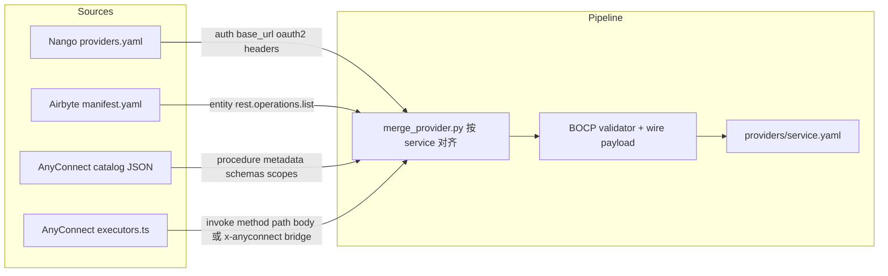

# BOCP Provider 分批迁移计划

**Status:** living plan（与 [progress.md §3.3](../progress.md) 对齐，随合成管线落地更新）  
**Date:** 2026-10-20  
**Related:** [bocp.zh.md](bocp.zh.md) · [runtime.zh.md](runtime.zh.md) · [product.md](product.md) · [data-model.md §18](../data-model.md)

---

## 1. 目标与范围

### 1.1 要交付什么

将外部连接器资产 **合并为 BOCP v2 单文件 Provider bundle**：

```text
basis/core/connectors/providers/{service}.yaml
```

每个 bundle 至少包含：

| 块 | 用途 |
|----|------|
| `auth[]` | CHECK、OAuth/API Key/DSN 等（控制台连接受权） |
| `actions[]` | `kind: entity`（DISCOVER / LIST / MUTATE → 账本同步）或 `kind: procedure`（INVOKE → Agent / MCP） |
| `spec` | `protocol: rest \| sql`；REST 可选 OpenAPI sidecar |

**不在本计划内：** 继续维护 Node AnyConnect 运行时、双栈 HTTP 桥（除非某批 provider 在截止日前无法声明式化，见 §8）。

### 1.2 成功标准（全局 DoD）

1. **Catalog：** `ConnectorCatalog.load_from_directory()` 加载全部已发布 YAML，Pydantic 校验 0 错误。  
2. **Conformance：** `tests/test_bocp_phase*.py` + 新增 `tests/test_provider_conformance.py`（按批增量）对每批 provider 做 wire payload、operations 闭包、auth 必填项检查。  
3. **Runtime：** 每批至少 **1 个 entity** 或 **1 个 procedure** 有真实集成测试（`.env.test` 或 CI secret），见 [`.env.test.example`](../../.env.test.example)。  
4. **产品：** 平台默认 allowlist 按批放开；KB 控制台目录可搜索、可 CHECK、策略/MCP 工具名与 manifest 一致。  
5. **文档：** `display_name`、`description`、OAuth scope 提示足以支撑控制台与 MCP 描述（不要求 10k action 每条都手写长文）。

### 1.3 当前基线（2026-10）

| 指标 | 现状 |
|------|------|
| 已发布 `providers/*.yaml` | **8**：`postgres`、`mysql`、`github`、`slack`、`notion`、`gitlab`、`jira`、`hubspot`（`build_connector_manifests.py --all-batches`） |
| 合成脚本 | `merge_service()` + Nango auth + AnyConnect procedures；**Slack 可无 `slack.py` 生成器**（`catalog_procedures_only`） |
| AnyConnect 目录（参考） | `fellowos/connectors/catalog/apps/*.json` ≈ **1,381** app；actions 元数据丰富，**无** REST path（逻辑在 `executors.ts`） |
| Nango | `packages/providers/providers.yaml` ≈ **1,058** 条，偏 **auth/proxy** |
| Airbyte 声明式源 | `manifest.yaml` ≈ **539**，偏 **entity `list`** 与分页 |
| 动态 MCP | `connector_{service}__{action}__{primitive}` 已接 manifest `actions[]` |

---

## 2. 三源合并策略（避免「合成完却不能跑」）



### 2.1 按能力分工（规范）

| 来源 | 优先吸收 | 产出 BOCP 形态 | 缺口处理 |
|------|----------|----------------|----------|
| **Nango** | `auth_mode`、`base_url`、`oauth2`、`authorization_url`、`proxy` 相关 headers | `auth[]` | 通常 **无** `actions`；不单独发「仅 auth」provider 除非 Batch 0.5 目录占位 |
| **Airbyte** | `streams` / `definitions.streams` 的 GET list、分页、增量、`record_selector` | `kind: entity` + `rest.operations.list`（及已有 mutation 块） | 需映射 Airbyte 类型 → `StreamFieldSpec`；复杂 `SubstreamPartitionRouter` → `x-basis-partition-router` |
| **AnyConnect** | `actions[].id`、`inputSchema`、`outputSchema`、`requiredScopes`、分类与文案 | `kind: procedure` + `rest.operations.invoke` | JSON **无 path**：Batch 工具链从 `executors.ts` **静态提取** 或标记 `x-anyconnect-executor-id` + 过渡期 Sidecar（§8） |
| **手写** | 旗舰 REST/SQL（GitHub issues、SQL discover） | 与现 `adapters/rest/providers/github.py` 同模式 | 作为 **黄金样本** 与合成结果 diff |

### 2.2 单 provider 合并优先级（冲突时）

1. **auth：** Nango > AnyConnect provider definition > Airbyte spec connection  
2. **entity list/read：** Airbyte > 手写  
3. **entity mutate：** 手写 / Airbyte 写回块 > 无则暂不发布 mutate  
4. **procedure invoke：** AnyConnect 元数据 + executor 编译 > 无 invoke 则不发布该 procedure  

**禁止：** 同一上游 HTTP 调用既作为 entity operation 又作为 procedure（BOCP §7.4 SHOULD NOT）。

### 2.3 发布等级（每 provider 标签）

合成后为每个 service 打标，决定默认是否进平台 allowlist：

| 等级 | 含义 | 默认上架 |
|------|------|----------|
| **GA** | CHECK + 至少一种 primitive 集成测绿 | 是 |
| **Beta** | CHECK 可跑；LIST 或 INVOKE 仅 smoke | 否（opt-in） |
| **Catalog** | 仅目录/MCP 发现；invoke 占位 | 否 |
| **Blocked** | 校验失败或缺 auth | 不写入 `providers/` |

---

## 3. 工程分期（管线先于大批量）

在 **Batch 1** 之前完成（约 1–2 周），否则后批只是堆 YAML。

| 里程碑 | 交付物 | 验收 |
|--------|--------|------|
| **P0** | `basis/core/connectors/synthesis/`（或 `scripts/synthesis/`）`merge_service(service) -> ConnectorManifest` | 对 `github` 合成结果与现手写 manifest **语义等价**（允许字段顺序差异） |
| **P1** | Nango → `auth[]` 导入器 | 随机抽 20 个 service 校验 OAuth 块 |
| **P2** | Airbyte → `entity` 导入器 | 抽 10 个有 `manifest.yaml` 的源，LIST 与 Airbyte 文档 path 一致 |
| **P3** | AnyConnect catalog → `procedure` 导入器 | 输出 schema；invoke path 覆盖率报表 |
| **P4** | Executor 提取器（TS AST 或维护的 JSON 索引） | Slack/GitHub 等样本 `invoke` 可 `execute_tool` |
| **P5** | `build_connector_manifests.py --batch N` / `--services a,b,c` | CI job `provider-conformance` 按批跑 |
| **P6** | `scripts/validate_providers.py`：统计 GA/Beta/Catalog、auth 覆盖率、action 数 | PR 门禁：新增 YAML 必须带等级注释或 sidecar `x-basis-ship-tier` |

**目录约定（保持 flat）：**

```text
basis/core/connectors/providers/
  github.yaml
  slack.yaml
  github.openapi.yaml          # 仅当需要 OpenAPI sidecar
```

**不要**恢复 `providers/{service}/connector.yaml` 深层目录（已统一到 flat `*.yaml`）。

### 3.1 不必每个 provider 一个 Python 文件

| 阶段 | 做法 |
|------|------|
| **常态** | `merge_service(service)` 写出 `providers/{service}.yaml`；运行时只读 YAML |
| **手写 `.py`** | 仅旗舰/回归样本（如 `github`）、SQL 共用模块、或合成器尚未覆盖时的临时兜底 |
| **Slack 示范** | `batch_1.yaml` 的 `catalog_procedures_only: [slack]` → 23 条 procedure 来自 AnyConnect JSON + `slack_invoke_map` / `executors-index.json`，auth 来自 Nango |

环境变量见 [`.env.synthesis.example`](../../.env.synthesis.example)；覆盖率：`uv run python scripts/synthesis_catalog_report.py`。

---

## 4. 分批原则

### 4.1 排序维度（加权）

每候选 provider 算 **迁移优先级分**：

| 因子 | 权重 | 说明 |
|------|------|------|
| 企业 SaaS 渗透率 | 40% | Gartner / 常见栈：微软、Google、Slack、Salesforce、Atlassian… |
| Basis 用户场景 | 25% | 研发（GitHub/GitLab）、协作（Notion/Slack）、CRM（HubSpot）、工单（Jira/Zendesk）、财务（Stripe） |
| 合成可行度 | 20% | Airbyte 有完整 list + Nango 有 auth → 高分；仅 AnyConnect procedure → 依赖 P4 |
| 认证复杂度 | 10% | `oauth2` 标准 > `two_step` / 非标 envelope |
| 合规与风险 | 5% | 医疗/金融特殊域可后移 |

### 4.2 每批规模

| 类型 | 每批数量 | 周期建议 |
|------|----------|----------|
| **旗舰手写 + 合成对齐** | 1–3 | 1 周 |
| **高优先级 SaaS** | 8–15 | 2 周 |
| **中优先级** | 20–40 | 2–3 周 |
| **长尾** | 50–100+ | 按覆盖率机器合并，人工只处理失败集 |

每批结束：**更新平台默认 allowlist 建议集**、release note、`progress.md` 表。

---

## 5. 分批路线图

### Batch 0 — 已交付（维持）

| service | 类型 | 来源 | 说明 |
|---------|------|------|------|
| `postgres` | SQL entity | 手写 | `table_records` + DISCOVER |
| `mysql` | SQL entity | 手写 | 同上 |
| `github` | REST entity + procedure | 手写 | `repositories`、`issues`；`get_authenticated_user` invoke |

**维护：** 生成器为源真相；`uv run python scripts/build_connector_manifests.py` 写 YAML；集成测 `.env.test`。

---

### Batch 1 — P0 管线 + 协作三件套（预计 2 周）

**目标：** 证明「三源合并 + 真实 INVOKE/LIST」闭环，优先 **用户每日打开** 的工具。

| 顺序 | service | 主要动作类型 | 合成来源 | 集成测要点 |
|------|---------|--------------|----------|------------|
| 1.1 | `slack` | procedure 为主 | AnyConnect + executor 编译 | PAT/OAuth；注意 form body 与 JSON 适配 |
| 1.2 | `notion` | entity + procedure | Airbyte list + AnyConnect | 动态 schema loader（已有 curated_dev 样本） |
| 1.3 | `google_drive` 或 `google_sheets` | entity | Airbyte + Nango | OAuth2 PKCE；选 **一个** 先 GA |
| 1.4 | `microsoft_teams` 或 `outlook` | entity + procedure | Nango + AnyConnect | 微软 Graph 分页与 scope 文档化 |

**Batch 1 DoD：**

- [ ] P0–P4 最小闭环对 `slack` 至少 3 个 procedure INVOKE 绿  
- [ ] 4 个 service 进 `providers/` 且 `ship-tier: beta|ga`  
- [ ] `tests/test_provider_conformance_batch1.py`  
- [ ] 控制台 catalog 分类与图标（AnyConnect `icon` URL 或本地缓存策略）

---

### Batch 2 — 研发 / 项目管理（预计 2 周）

| 顺序 | service | 场景 | 备注 |
|------|---------|------|------|
| 2.1 | `gitlab` | 代码仓、issues MR | **进行中**：`projects` + `project_issues` entity + 15 catalog procedure |
| 2.2 | `bitbucket` | 同上 | 企业用户 |
| 2.3 | `jira` | 工单 entity + 状态 mutate | **进行中**：`issues` entity（OAuth `cloudId` + `projectKey`）+ 7 procedure |
| 2.4 | `linear` | 现代 issue 跟踪 | procedure 多 |
| 2.5 | `asana` | 任务 | entity list |
| 2.6 | `monday` | 看板 | 动态字段 |

**优先 entity：** issues / projects / tasks 类 stream，直接对接账本映射。

---

### Batch 3 — CRM / 销售 / 支持（预计 2–3 周）

| 顺序 | service | 场景 |
|------|---------|------|
| 3.1 | `hubspot` | contacts、companies、deals（curated_dev 已有内部样本，提升为 shipped） |
| 3.2 | `salesforce` | accounts、contacts、opportunities |
| 3.3 | `zendesk` | tickets、users |
| 3.4 | `intercom` | conversations |
| 3.5 | `freshdesk` | 工单 |
| 3.6 | `pipedrive` | 管线 |

**说明：** CRM 自定义字段多，依赖 `DISCOVER` / `x-basis-dynamic-schema-loader`；Batch 3 前确认 P2 Airbyte 字段映射覆盖率。

---

### Batch 4 — 数据与表格 / 自动化（预计 2 周）

| 顺序 | service | 场景 |
|------|---------|------|
| 4.1 | `airtable` | bases / records（curated_dev → shipped） |
| 4.2 | `google_sheets` | 若 Batch 1 未做 |
| 4.3 | `airtable` 竞品：`smartsheet`、`coda` | 按需 |
| 4.4 | `zapier`（若 manifest） | 元数据为主，可能仅 procedure |
| 4.5 | `postgres` 外延 | **不重复**；可选 `snowflake`、`bigquery` SQL 类新 provider |

---

### Batch 5 — 财务 / 电商 / 营销（预计 2–3 周）

| 顺序 | service | 场景 |
|------|---------|------|
| 5.1 | `stripe` | customers、charges、subscriptions |
| 5.2 | `shopify` | orders、products |
| 5.3 | `paypal` | 支付 |
| 5.4 | `mailchimp` | audiences、campaigns |
| 5.5 | `sendgrid` | 邮件发送 procedure |

**风险：** 写操作多；默认 `action_policy` 对 mutate/destructive procedure 保守。

---

### Batch 6 — 云与 DevOps（预计 2–3 周）

| 顺序 | service | 场景 |
|------|---------|------|
| 6.1 | `aws`（拆子 service 或 `aws_s3` / `aws_ec2`） | 按 AnyConnect 拆分习惯 |
| 6.2 | `gcp` | 存储 / BigQuery |
| 6.3 | `azure` | 资源组级 |
| 6.4 | `cloudflare` | DNS / Workers |
| 6.5 | `datadog` | monitors、metrics |
| 6.6 | `sentry` | issues |
| 6.7 | `pagerduty` | incidents |
| 6.8 | `github_actions` | 可与 github 合并或子 bundle |

---

### Batch 7 — 长尾（滚动）

| 策略 | 说明 |
|------|------|
| **机器批** | 剩余 AnyConnect catalog（~1000+）按 **Nango auth 命中 + Airbyte list 命中** 自动合并为 `Catalog` 级 |
| **人工晋升** | 客户工单 / 内部用量 Top N 每月从 Catalog → Beta → GA |
| **去重** | 同一 API 多 brand（如 `google_*`）合并 `service` 命名规则见 [bocp §7.2](bocp.zh.md) |
| **下线** | `Blocked` 或 6 个月无 CHECK 成功的从目录隐藏 |

---

## 6. 单批执行清单（模板）

每个 Batch 重复以下步骤（PR 可一批一 PR 或 service 一 PR + 批标签）：

1. **选型：** 从本节表格取 service 列表；在合成器配置 `batches/batch_N.yaml` 记录来源路径。  
2. **合成：** `uv run python scripts/build_connector_manifests.py --batch N`  
3. **校验：** `uv run python scripts/validate_providers.py --batch N --min-tier beta`  
4. **测试：**  
   - 单元：manifest wire、MCP 工具名展开  
   - 集成：扩展 `.env.test.example`（每 service 可选变量）；CI 用 org secret  
5. **产品：**  
   - 默认 allowlist 增量（`settings.connector_allowed_providers` 文档化）  
   - KB 控制台 smoke  
6. **文档：** 更新本计划批状态、 [runtime.zh.md](runtime.zh.md) 已知缺口表  

---

## 7. 测试与 CI 策略

| 层级 | 内容 |
|------|------|
| **L0** | 全量 YAML schema + `manifest_wire_payload` 往返 |
| **L1** | 每批 1 个「代表 service」真实 CHECK（`.env.test`） |
| **L2** | 每批 1 个 entity LIST + 1 个 procedure INVOKE（有则测） |
| **L3** | 可选 nightly：对 Beta 全量 CHECK（限流） |

**CI：**

- 保持 `BASIS_TEST_POSTGRES_URL`（已有）  
- 新增 org secrets：`BASIS_TEST_GITHUB_*`（已有范例）、按批增加 `BASIS_TEST_SLACK_*` 等  
- 无 secret 的 service：**不失败**，`pytest.skip` + 报告覆盖率  

---

## 8. 风险与过渡方案

| 风险 | 缓解 |
|------|------|
| AnyConnect executor 无法静态提取 | 短期：`x-anyconnect-action-id` + 可选 HTTP 桥（**仅 dev**）；中期：维护 `executors-index.json` 构建产物 |
| Slack 等 `application/x-www-form-urlencoded` | REST 适配器扩展 `body_encoding: form`（Batch 1 前） |
| 合成数量导致仓库体积 | 单文件 YAML &lt;500KB 限制；超大 action 列表拆 `x-basis-actions-ref` sidecar（需协议扩展则走 BOCP patch） |
| OAuth 回调多租户 | 沿用 `kb_oauth_configs`；每批验证 redirect URL |
| progress.md「1060 done」与真实 shipped 不符 | 每批合并后更新 **shipped 计数** 与 **Catalog 计数** 分列 |

---

## 9. 里程碑时间表（示意）

```text
2026-10  W1–2   Batch 0 维护 + P0–P3 管线
2026-11  W1–2   Batch 1 协作
2026-11  W3–4   Batch 2 研发 PM
2026-12  W1–3   Batch 3 CRM
2026-12  W4     Batch 4 表格
2027-01          Batch 5–6 财务 / 云
2027-Q1+         Batch 7 长尾 + 晋升机制
```

（日期随人力调整；以 **每批 DoD** 为准。）

---

## 10. 附录

### A. 热门 service 与 AnyConnect id 对照（节选）

合成时 `service` 用 BOCP 规则：`^[a-z0-9][a-z0-9_-]*$`。AnyConnect 点号 id（如 `slack.post_message`）→ procedure `id` 保留或规范为短名（与 MCP 工具名一致，全仓统一一种）。

| 优先级 | BOCP `service` | 典型 AnyConnect / Nango id |
|--------|----------------|----------------------------|
| P0 | `github` | `github`（已 shipped） |
| P1 | `slack` | `slack` |
| P1 | `notion` | `notion` |
| P1 | `google_sheets` | `google-sheets` / `google_sheets` |
| P1 | `microsoft_teams` | `microsoft-teams` |
| P2 | `gitlab` | `gitlab` |
| P2 | `jira` | `jira` |
| P3 | `hubspot` | `hubspot` |
| P3 | `salesforce` | `salesforce` |
| P5 | `stripe` | `stripe` |

### B. 与现有代码入口

| 路径 | 作用 |
|------|------|
| `scripts/build_connector_manifests.py` | 扩展为批构建入口 |
| `basis/core/connectors/provider_bundle.py` | 读写 flat YAML |
| `basis/core/connectors/catalog.py` | 扫描 `providers/*.yaml` |
| `basis/core/connectors/adapters/rest/curated_dev.py` | 旗舰样本（迁移到 shipped 前的试验田） |
| `basis/integration/mcp_connector_tools.py` | 动态 MCP |
| `tests/test_connector_primitive_invoke.py` | 真实集成测模板 |

### C. 批状态跟踪（手动更新）

| Batch | 状态 | Shipped services | 备注 |
|-------|------|------------------|------|
| 0 | done | postgres, mysql, github | 手写生成器 + `merge_service` |
| 1 | in progress | slack, notion (beta) | form invoke、database_pages entity、P2 airbyte 占位 |
| 2–7 | planned | — | |

---

**维护：** 每批合并 PR 更新 §10.C 与 [progress.md](../progress.md) §3.3 连接器行。
