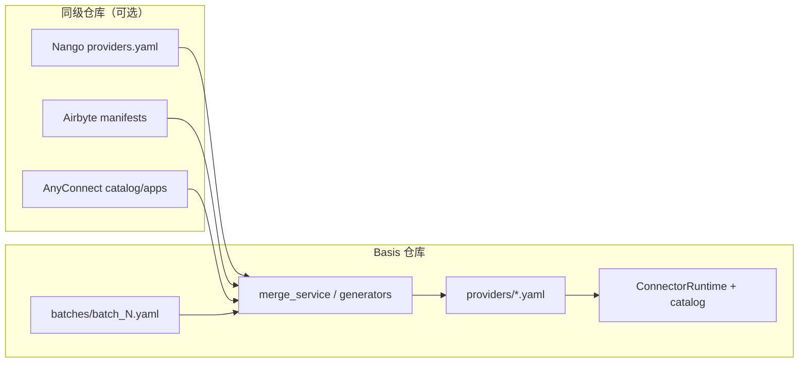

# BOCP Provider 合成流水线

**读者：** 要改 `basis/domain/integration/providers/*.yaml`、扩 batch、或对接同级 Nango/Airbyte/AnyConnect 仓的贡献者。  
**协议与运行时：** [bocp.zh.md](bocp.zh.md)、[runtime.zh.md](runtime.zh.md)。**分批计划与 DoD：** [provider-migration.zh.md](provider-migration.zh.md)。

## 这条流水线解决什么问题

Basis 运行时只读 **已提交** 的 BOCP bundle（`basis/domain/integration/providers/<service>.yaml`）。这些文件可以手写维护，也可以从**外部资产**合成后写回仓库：

| 上游 | 用途 | 默认探测路径（相对 `basis` 仓库） |
| --- | --- | --- |
| **Nango** | OAuth/API 认证模板 | `../../nango/packages/providers/providers.yaml` |
| **Airbyte** | 声明式 source `manifest.yaml` | `../../airbyte/airbyte-integrations/connectors` |
| **AnyConnect**（fellowos connectors） | 动作目录、invoke 元数据 | `../connectors/catalog/apps` 或 `../../fellowos/connectors/catalog/apps` |

路径解析在 `basis/domain/integration/synthesis/paths.py`；可用环境变量覆盖（见仓库根目录 [`.env.synthesis.example`](../../../.env.synthesis.example)）。

## 数据流（一张图）



- **合成逻辑：** `basis/domain/integration/synthesis/`（`merge.py`、`generators.py`、`batches/`、`nango_auth.py`、`anyconnect_catalog.py` 等）。
- **构建入口：** `scripts/build_connector_manifests.py`。
- **产物目录：** `basis/domain/integration/providers/`（随包发布，`pyproject.toml` package-data）。

## 日常命令

在 **Basis 仓库根** 执行：

```bash
# 查看内置 generator 认识的 service id
uv run python scripts/build_connector_manifests.py --list-services

# 按 batch 定义合成并写 YAML（默认开启 --synthesize）
uv run python scripts/build_connector_manifests.py --batch 0

# 所有 batch_*.yaml
uv run python scripts/build_connector_manifests.py --all-batches

# 指定服务；可选 ship tier
uv run python scripts/build_connector_manifests.py --services github,slack --tier beta

# 仅用 Python generator、不拉三源 overlay（旧行为）
uv run python scripts/build_connector_manifests.py --batch 0 --no-synthesize
```

当前随版 batch 与 service 列表见 `basis/domain/integration/synthesis/batches/`；已发布 YAML 数量与迁移阶段见 [provider-migration.zh.md §现状](provider-migration.zh.md)。

### 上游路径未找到时

1. 将同级仓 clone 到 `../nango`、`../airbyte`、`../fellowos/connectors` 等（与 `paths.py` 候选一致），或  
2. 复制 `.env.synthesis.example` 为 `.env.synthesis`（勿提交），设置 `BASIS_SYNTHESIS_*` 绝对路径，再在 shell 中 `export` 或 `source`。

合成**不**在普通 `uv run basis` 启动时执行；改 YAML 后重启 API 即可加载新 catalog。

### 覆盖率报告（不写文件）

```bash
uv run python scripts/synthesis_catalog_report.py
```

需要 AnyConnect catalog 目录存在；用于看 Nango 命中与 invoke 就绪情况（见 migration 文档 P0–P5）。

## 改什么、提交什么

| 场景 | 改哪里 | Git |
| --- | --- | --- |
| 协议字段、校验 | `manifest_schema.py`、`bocp.md` | 代码 + 文档 |
| 合成规则 | `synthesis/merge.py`、`*_invoke_map.py` | 代码 |
| 扩一批 provider | `synthesis/batches/batch_N.yaml` + 跑 build 脚本 | batch YAML + 生成的 `providers/*.yaml` |
| 单服务手写维护 | 直接编辑 `providers/<service>.yaml` | YAML（需过 schema 与集成测） |

**不要**提交 `.env.synthesis` 或含本机绝对路径的 secrets。

## 验证

- 单测：`uv run pytest tests/test_bocp_phase1.py tests/test_mcp_connector_tools.py -q`（按改动扩大范围）。
- 全量：`uv run pytest -q`。
- 改 manifest 后若 OpenAPI/MCP 工具面有变：按 [openapi-v1.md](../openapi-v1.md) 与 AGENTS.md 跑 `scripts/generate-openapi-v1.py`（仅当 HTTP 面受影响）。

## 与其它文档的分工

| 文档 | 内容 |
| --- | --- |
| [product.md](product.md) | 为何单一 Python 引擎、菜单与账本入出向 |
| [provider-migration.zh.md](provider-migration.zh.md) | 分批迁移、P0–P5、CI `provider-conformance` 规划 |
| [runtime.zh.md](runtime.zh.md) | 运行时如何加载 bundle、MCP/HTTP 宿主行为 |
| **本文** | 从外仓到 `providers/*.yaml` 的操作路径 |
