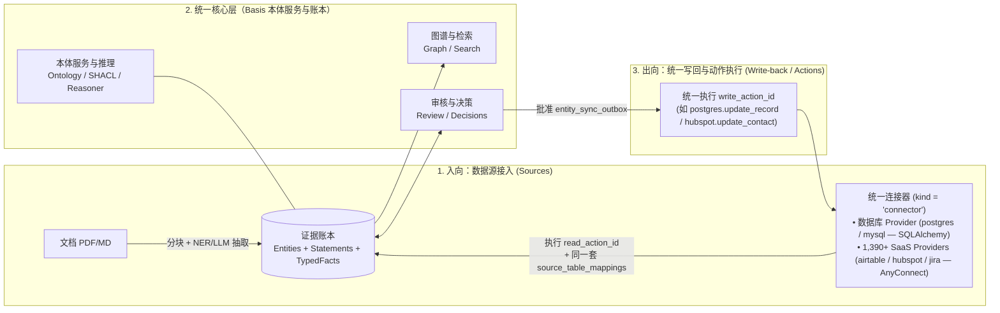
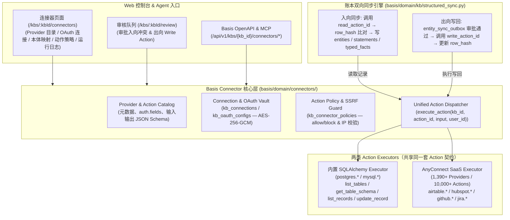
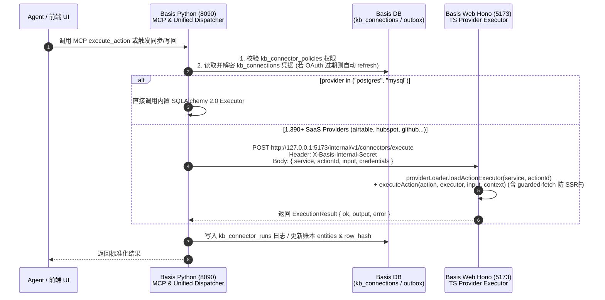

# Helix Foundry 能力借鉴与 Basis 统一架构落点

**Status:** accepted reference（架构决策见 [ADR 0003](0003-lakehouse-datasets.md) 与 [data-model.md §18](data-model.md)）  
**Date:** 2026-10-18  
**Related:** [ADR 0001 — 证据账本](0001-canonical-knowledge-model.md) · [ADR 0003 — 结构化源与实体双向同步](0003-lakehouse-datasets.md) · [data-model.md §18](data-model.md) · [features.md §5.16–5.18](../features.md)

## 1. 核心结论：中间完全统一，只扩“两头”，联合 AnyConnect 形成闭环

对比 [Helix Foundry](https://github.com/helixdb/helix-foundry)（多源连接器、跨源实体对齐、业务对象操作）、同级项目 **AnyConnect（`fellowos/connectors`，基于 `oomol-lab/open-connector` 的 1,000+ SaaS 连接器与 10,000+ Actions 网关）** 与 Basis 后，Basis **不搞第二套菜单、不建独立的 Parquet 数据湖、不引入 DuckDB SQL 沙箱**。

在 FellowOS 体系中，进一步将**关系型数据库（PostgreSQL / MySQL，底层由 SQLAlchemy 2.0 驱动）**与 **AnyConnect 的 1,390+ SaaS Providers** 彻底抽象为**同一套「Provider + Read/Write Action」模型（`ingest_sources.kind = 'connector'`）**。这样一来，不管是数据库表还是 SaaS 对象，入向全部走 **`read_action_id` → `source_table_mappings` → 进账本**，出向全部走 **`Review` → `entity_sync_outbox` → `write_action_id` 写回**：

---

## 2. 菜单设计：在「数据与抽取」下新增独立的「连接器」菜单

**为什么不塞进「资料 (`sources`)」页？**
- 现有 `资料` 页（`/kbs/:kbId/sources`）面向的是**非结构化文档**（「添加文档」弹窗中的上传文件、粘贴文本、从 URL 获取）。
- 而 **Basis Connector（数据库 + AnyConnect 1,390+ SaaS）** 面向的是**外部业务系统连接、OAuth2 凭据、表/对象到本体的双向映射、10,000+ Actions 与调用日志**，与“文档资料”并不是一回事。

因此，删掉 `资料` 页原有的连接器弹窗与按钮，仅在「添加文档」弹窗保留第 3 个 Tab（`从 URL 获取`），并在左侧栏 **`数据与抽取`（`KB_NAV_BY_ZONE.knowledge`）** 下直接新增独立的 **`连接器`（`/kbs/:kbId/connectors`）** 菜单项：

### 2.1 左侧栏 `数据与抽取` 菜单结构（`web/src/lib/nav-config.ts`）

| 菜单项 | 路由路径 | 定位与职责 |
| --- | --- | --- |
| **资料** (`sources`) | `/kbs/:kbId/sources` | **非结构化文档入口**：上传文件、粘贴文本、从 URL 获取文档，产出 `documents` 与 `chunks` |
| **连接器** (`connectors`，**新增**) | `/kbs/:kbId/connectors` | **结构化数据库与 1,390+ SaaS 统一入口**：承接 AnyConnect 全部功能与表/Action 本体映射 |
| **处理任务** (`processing`) | `/kbs/:kbId/processing` | 文档切分/抽取任务队列与后台同步 Job 状态 |
| **实体账本** (`entities`) | `/kbs/:kbId/entities` | 统一查看文档抽取与连接器同步进来的所有实体，支持外部字段内联修改与触发写回 |
| **实体解析** (`entity-resolution`) | `/kbs/:kbId/entity-resolution` | 跨文档、跨数据库/SaaS 的同名/同键实体对齐与合并 |
| **决策记录** (`decisions`) | `/kbs/:kbId/decisions` | 审计所有人工与 Agent 的审批决策（`agent_decisions`） |
| **审核队列** (`review`) | `/kbs/:kbId/review` | 统一审批文档抽取冲突、入向同步冲突（`statement_conflict`）与出向业务系统写回（`entity_writeback`） |

### 2.2 新增「连接器 (`/kbs/:kbId/connectors`)」页面内部的 4 个 Tab

将 AnyConnect（`fellowos/connectors/packages/web`）的页面内聚在 `/kbs/:kbId/connectors`（`web/src/pages/kb/connectors.tsx`）中，不再分散到其他页面：

| `/kbs/:kbId/connectors` 内部 Tab | 对应原 AnyConnect 组件 | 核心功能 |
| --- | --- | --- |
| **Tab 1：连接与服务目录 (`Connections & Providers`)** | `providers.tsx` | 顶部展示当前 KB 已激活的连接（`postgres`、`mysql`、`airtable`、`hubspot` 等）；下方浏览/搜索 1,390+ Providers，点击抽屉配置 DSN / API Key / OAuth2 授权（支持 KB 默认连接与成员个人连接） |
| **Tab 2：本体映射与同步 (`Ontology Mappings`)** | Basis 新增映射器 | 配置 `source_table_mappings`：选择已连接的数据库表或 SaaS `read_action_id` / `write_action_id`，指定主键列、名称列，将字段映射为本体类（`target_class_uri`）与谓词（`predicate_uri`），设置入向/双向写回模式并一键触发同步 |
| **Tab 3：动作目录与策略 (`Actions & Policy`)** | `actions.tsx` + `access.tsx` | 搜索/调试 10,000+ Actions（查看入参/出参 JSON Schema 与 Agent Markdown 指南），配置当前 KB 的 `kb_connector_policies`（允许/禁止的 Providers 与 Actions 白名单，落地 `F-OPS-02`） |
| **Tab 4：运行日志 (`Runs`)** | `runs.tsx` | 查看 `kb_connector_runs`：每次入向拉取与出向 Action 执行的脱敏输入/输出快照、耗时、状态码与报错详情 |

---

## 3. 从 Helix Foundry 借鉴什么、砍掉什么

### 3.1 直接借鉴并融入统一账本的能力

| Foundry 能力 | 在 Basis 统一架构中的落点 | 对应 `F-*` |
| --- | --- | --- |
| **连接器测试连接与表/列发现**（`information_schema` 主外键探测） | 扩展 `Sources` 添加向导：探测表、主键、外键，自动生成「列 → 本体属性」映射草稿 | `F-SRC`、`F-OPS-04` |
| **跨源同一实体对齐**（如同一客户在 DB 和 Stripe 的键匹配） | 写入 `entity_external_refs`，通过外部主键（`external_key`）或邮箱等对齐列合并到同一个 Basis `entity_id`（必要时进 `Review` 实体合并） | `F-IDN`、`F-OPS-04` |
| **定时快照与增量比对**（基于 `row_hash` 判断哪些行变了） | 同步作业仅对 `row_hash` 变化的行 Supersede 旧 `statements`，避免全表重写账本 | `F-OPS-05` |
| **对象级编辑与前后预览（Before / After Preview）** | 修改绑定了业务库的实体属性或触发 Action 时，在 `Review` 展示变更前后对比，批准后写回外部库 | `F-OPS-01`、`F-GOV` |
| **连接器凭据加密与安全 URL 校验**（防云元数据 SSRF） | 复用平台加密设置存数据库密码；连接器复用安全 URL/Host 校验 | `F-ACC`、`F-SRC` |

### 3.2 明确砍掉（不迁移）的设计

| Foundry 做法 | 为什么 Basis 不需要 |
| --- | --- |
| **独立的 Parquet 数据集目录 + DuckDB Executor 容器** | 业务实体已直接映射进 Basis 账本（SQLite/Postgres），查询统一走实体/图谱/SPARQL，无需再维护一套 OLAP 数仓 |
| **Home BI 仪表盘与自由 SQL 问数（Analyst）** | Basis 是企业知识与语义底座，不是 BI 报表工具；Agent 统一通过 MCP 查实体与图 |
| **HelixDB 存储与无账号单机模型** | Basis 已有完善的组织租户（ADR 0002）、KB 角色权限与证据账本 |

---

## 4. 双向同步（实体 ↔ 业务数据库）核心机制与账本对齐

> **完整 DDL 与 JSON Schema 见 [data-model.md §18](data-model.md)。** 开发实现时必须遵守以下与现有 `0002_knowledge_ledger.sql` 及 `projector.py` 对齐的硬性约束：

### 4.1 账本表与图投影对齐（避免踩坑）
1. **禁止向 `statement_evidence` 插入无文档的记录**：
   - `0002_knowledge_ledger.sql` 中 `statement_evidence.chunk_id` 是 `NOT NULL REFERENCES chunks(id)`。结构化数据库行没有文档分块（`chunk_id`），因此**绝不写入 `statement_evidence`**。
2. **标准写入方式（`statements` + `typed_facts`）**：
   - 每个映射列写入一条 `statements`（`proposed_by = 'connector'`，`status = 'confirmed'`，`surface_phrase = column_spec.surface_phrase`）。`store.py:list_statements_for_projection` 使用 `LEFT JOIN statement_evidence`，因此无 `statement_evidence` 仍能正常投影。
   - 若该列配置了本体 `predicate_uri`，同时写入 `typed_facts`（`from_statement_id = statement.id`，`import_provenance_json` 记录 `{"kind": "structured_source", "source_id": ..., "mapping_id": ..., "external_ref_id": ..., "external_table": ..., "external_pk": ..., "column": ...}`）。
   - `projector.py:rebuild_graph_from_ledger` 会自动去重同一三元组的 open statement 与 typed fact，将实体属性/外键关系直接投影到 `ContextGraph`。
3. **决策外键表名**：
   - `entity_sync_outbox.decision_id` 外键必须指向 **`agent_decisions(id)`**（`0002_knowledge_ledger.sql` 真实表名），而非 `decisions(id)`。
4. **实体删除级联（`basis/domain/kb/entity_delete.py`）**：
   - 删除实体时，必须在 `entity_delete.py` 中先清理 `entity_sync_outbox`、`entity_external_refs` 以及 `subject_type = 'entity_sync_outbox'` 的 `review_items`。

### 4.2 入向同步事务（业务库 → Basis 实体）
1. **拉取与比对**：连接器按 `source_table_mappings` 拉取目标表（受 `max_rows` 保护，默认 `10000`），仅提取 `label_column` 与 `column_mappings_json` 中的列，按 `json.dumps(..., sort_keys=True, separators=(",", ":"))` 计算 SHA-256 `row_hash` 并与 `entity_external_refs.row_hash` 对比。
2. **定位或创建实体**：
   - 按 `(kb_id, source_id, external_table, external_pk)` 查找 `entity_external_refs`；
   - 若不存在，先按对齐规则（如 `external_key = "{source_id}:{external_table}:{external_pk}"` 或唯一业务键）查找或创建 `entities`（`canonical_label = row[label_column]`）并写入 `rdf:type = target_class_uri` 的 `typed_facts`。
3. **增量更新与冲突保护**：
   - **无冲突更新**：若某列值变化，且当前生效的同名 `surface_phrase` 陈述为 `proposed_by = 'connector'`，在同一事务内将旧 `statements` / `typed_facts` 设为 `invalidated_at = now`（并设置新行的 `supersedes_id`）。
   - **本地修改冲突保护**：若该 `(subject_id, surface_phrase)` 存在 `proposed_by IN ('user', 'agent')` 的有效陈述且值与上游不同，保留二者并调用 `scan_statement_conflicts(knowledge, kb_id)` 生成 `kind = 'statement_conflict'` 审核项。

### 4.3 出向同步事务（Basis 实体 → 业务库写回）
1. **发起变更**：用户在实体面板编辑了绑定外部可写列（`writable = true`）的属性，或 Agent 调用写回接口。
2. **治理闸口（Outbox + Review）**：
   - 写入 `entity_sync_outbox`（`status = 'pending_review'`，`patch_json` 记录 `{external_table, primary_key_column, external_pk, changes: {col: {old, new, predicate_uri, statement_id}}}`）。
   - 若 `writeback_mode = 'review'`，同时写入 `review_items`（`kind = 'entity_writeback'`，`subject_type = 'entity_sync_outbox'`，`subject_id = outbox.id`）。
   - 若 `writeback_mode = 'direct'`（且操作者具备 `kb.write` + `F-OPS-02` 权限），直接置 `status = 'queued'`。
3. **执行写回与防回环**：
   - 审核通过（`POST /api/v1/kbs/{kb_id}/review/{review_id}/decide`）后，记录 `agent_decisions`，将 outbox 置为 `queued` 并入队后台作业（`jobs.kind = 'entity_writeback'`）。
   - 连接器**严禁手写 SQL 字符串拼接**，必须使用 **SQLAlchemy 2.0 Core**（`sqlalchemy.Table(..., autoload_with=engine)` + `sqlalchemy.update(table).where(table.c[pk_col] == pk_val).values(**changes)`）执行方言安全的参数化单行 `UPDATE`。
   - 写回成功后，立即重算并更新 `entity_external_refs.row_hash` 与 `last_synced_at`（**消除下一轮定时拉取的回环冲突**），将 `entity_sync_outbox.status` 置为 `synced`。
   - 写回失败则置 `status = 'failed'`，记录 `error_code` / `error_detail_json` 并触发 `F-ALT` 告警。

---

## 5. REST API 与 MCP 接口契约（开发规范）

所有新增 HTTP 接口挂在现有 `/api/v1/kbs/{kb_id}/...` 路由下，遵循 `openapi_v1_export` 规范（每个 handler 必须包含 docstring，同步运行 `scripts/generate-openapi-v1.py` 更新 `openapi/basis-v1.json` 与前端 `schema.d.ts`）。

### 5.1 数据源与表映射接口（扩展 `basis/transport/http/routes/v1/kb_sources.py`）

| 方法与路径 | `operationId` 建议 | 权限 | 入参 / 返回摘要 |
| --- | --- | --- | --- |
| `POST /api/v1/kbs/{kb_id}/sources/test-connection` | `kbSourcesTestConnection` | `kb.write` | 入参：`{kind: "connector", provider: "postgres" \| "airtable" \| ..., config: {...}, secret: "..."}`；验证连接与 SSRF/Host 策略，返回 `{ok: true, detail: "..."}` 或 `422 connection_failed` |
| `GET /api/v1/kbs/{kb_id}/sources/{source_id}/schema` | `kbSourcesIntrospectSchema` | `kb.read` | 调用内置 `postgres.get_table_schema`（底层 `sqlalchemy.inspect(engine)`）或 SaaS Schema Action 返回表/资源、主键、字段类型与外键：`{tables: [{table: "public.suppliers", primary_key: "supplier_id", columns: [{name, data_type, nullable, fk_target_table}]}]}` |
| `GET /api/v1/kbs/{kb_id}/sources/{source_id}/mappings` | `kbSourceMappingsList` | `kb.read` | 返回该数据源下的 `source_table_mappings` 列表 |
| `PUT /api/v1/kbs/{kb_id}/sources/{source_id}/mappings` | `kbSourceMappingsUpsert` | `kb.write` | 入参：`{external_table, read_action_id, write_action_id, action_params, records_json_path, primary_key_column, label_column, target_class_uri, column_mappings, sync_direction, writeback_mode, max_rows}`；创建或更新映射配置 |
| `POST /api/v1/kbs/{kb_id}/sources/{source_id}/sync` | `kbSourcesSync`（复用现有） | `kb.write` | 复用现有触发端点：当 `source.kind == 'connector'` 时，调用映射绑定的 `read_action_id` 拉取记录并更新账本与图投影，返回 `{imported_rows, updated_entities, unchanged_rows, conflicts_created}` |

### 5.2 实体外部引用与写回接口（扩展 `kb_entities.py` / `kb_review.py`）

| 方法与路径 | `operationId` 建议 | 权限 | 入参 / 返回摘要 |
| --- | --- | --- | --- |
| `GET /api/v1/kbs/{kb_id}/entities/{entity_id}/external-refs` | `kbEntityExternalRefsList` | `kb.read` | 返回该实体绑定的 `entity_external_refs` 及未完成的 `entity_sync_outbox` 记录 |
| `POST /api/v1/kbs/{kb_id}/entities/{entity_id}/writeback` | `kbEntityWritebackPropose` | `kb.write` | 入参：`{external_ref_id, changes: {column: new_value}, note?: string}`；根据 `writeback_mode` 创建 `pending_review`（含 `review_item_id`）或 `queued` outbox 记录 |
| `POST /api/v1/kbs/{kb_id}/review/{item_id}/decide` | 复用现有决策端点 | `kb.review` | 在现有 handler 中新增对 `kind == 'entity_writeback'` 的分支：若 `decision == 'approve'`，将关联 `entity_sync_outbox` 置为 `queued` 并执行/入队写回；若 `reject`，置为 `rejected` 并回滚/作废待定 statement |

### 5.3 统一 MCP 服务入口（对外仅暴露 Python `basis-kb-mcp` 一个服务）
- **绝不拆成两个语言的 MCP 服务**：Agent 侧只连接 Basis Python 的**唯一 MCP 服务（`basis/integration/registry.py`）**。
- **读路径（13 个现有 KB 工具）**：`kb_search`、`kb_entity_get`、`kb_graph_neighbors`、`kb_sparql_query` 等直接读取账本中的实体与属性。
- **连接器与写回路径（将 AnyConnect 的 5 个固定 MCP 工具合并进 `basis/integration/`）**：
  - AnyConnect 的 `mcp.ts` 本身只是一层 150 行的薄壳（固定暴露 `list_apps`、`list_connections`、`search_actions`、`get_action_guide`、`execute_action` 5 个工具）。
  - 直接将这几个工具注册到 Python 的 `basis/integration/registry.py` 中（与 13 个 KB 工具同处一个 MCP Server）：
    - `search_actions` / `get_action_guide` / `list_connections`：直接查 Python 内存 Catalog 与 `kb_connections` 表；
    - `execute_action` / `kb_entity_propose_writeback`：在 Python 侧统一走 `kb_connector_policies` 权限校验与 `Review` 队列（或直通调用 `Unified Action Dispatcher`）。
  - **Node 22 端不对外暴露 MCP**：Node 端仅作为 `Unified Action Dispatcher` 底层调用的内部 TS Provider 执行器。

---

## 6. 开源主流框架选型与代码落点清单（禁止重复造轮子）

### 6.1 核心技术栈：全面复用已安装的主流开源框架

开发实现时**严禁手写 SQL 拼接器、严禁手写 `information_schema` 方言查询、严禁手写 `isinstance` 字典校验、严禁手写 CSV/Parquet 解析器**。必须直接使用仓库 `pyproject.toml` 与 `web/package.json` 中已安装的工业级开源库：

| 领域 | 采用的主流开源框架（均已在仓库安装） | 具体用法与禁止造轮子红线 |
| --- | --- | --- |
| **数据库表/主键/外键自动探测** | **SQLAlchemy 2.0 Reflection** (`sqlalchemy>=2.0` + `psycopg[binary,pool]>=3.2`) | 使用 `sqlalchemy.inspect(engine)` 的 `get_table_names()`、`get_pk_constraint()`、`get_columns()`、`get_foreign_keys()`。**禁止**手写针对特定数据库的 `SELECT * FROM information_schema...`，使架构天然兼容 PostgreSQL、MySQL、SQLite 等所有 SQLAlchemy 方言。 |
| **安全分批读取与参数化单行写回** | **SQLAlchemy 2.0 Core** (`sqlalchemy.Table`, `select`, `update`) | 使用 `Table(name, metadata, autoload_with=engine)` 构建 `select(table).limit(max_rows)` 与 `update(table).where(table.c[pk] == external_pk).values(**changes)`。由 SQLAlchemy 负责方言标识符转义（Quoting）、参数绑定与连接池（`pool_pre_ping=True`），**禁止**使用字符串格式化拼接 SQL。 |
| **JSON 契约校验与 OpenAPI 生成** | **Pydantic v2** (`pydantic>=2`) + **FastAPI** | `data-model.md §18.3` 中的 4 个 JSON 结构（`PostgresSourceConfig`、`ColumnMappingSpec`、`StructuredImportProvenance`、`OutboxPatchSpec`）全部定义为 `pydantic.BaseModel`，存取数据库一律用 `model_validate_json()` / `model_dump_json()`。**禁止**手写 `dict` 字段校验。 |
| **表格文件解析（CSV / Parquet）** | **PyArrow / Pandas** (`pyarrow>=14`, `pandas>=1.3`，已由 `semantica` 核心安装) | 读取表格文件 Schema 与数据流直接使用 `pyarrow.parquet` / `pyarrow.csv` 或 `semantica.ingest`。**禁止**手写文件流解析。 |
| **本体数据类型与约束校验** | **RDFLib + pySHACL** (`rdflib>=6.2`, `semantica[shacl]`) | 映射列的 `datatype`（如 `xsd:string`、`xsd:decimal`、`xsd:dateTime`）与实体属性校验直接复用 `rdflib.namespace.XSD` 与 `semantica` SHACL 校验器。 |
| **1,000+ SaaS 连接器与双向 Action** | **AnyConnect (`@fellow/connectors` / `open-connector`)** | **严禁**为 Notion/GitHub/HubSpot/Jira/Slack/Airtable 等 SaaS 重复手写 OAuth2 与 REST 客户端；直接复用同级项目 `fellowos/connectors`（AnyConnect）的 1,000+ Providers、OAuth2 凭据库与 10,000+ Actions 契约（见 §7 融合路径）。 |
| **前端类型、表单与状态管理** | **`openapi-typescript` + `openapi-fetch` + `react-hook-form` + `zod` + `@tanstack/react-query`** | 后端改完 Pydantic 模型后运行 `npm run gen:openapi-types` 自动生成前端 TS 类型；连接与映射弹窗使用 shadcn `Form` + `zod`；**禁止**手写前端 `fetch` 封装或非受控原生表单。 |

### 6.2 精确到文件的代码改动地图（供开发排期）

| 模块 | 新增 / 修改文件 | 职责说明 |
| --- | --- | --- |
| **数据库迁移** | 新增 `basis/platform/admin/migrations/0011_entity_external_sync.sql` 更新 `tests/test_migrations.py` | 落地 [data-model.md §18](data-model.md) 中的 **7 张表**（4 张 `kb_connector_*` 运行时表 + `source_table_mappings`、`entity_external_refs`、`entity_sync_outbox`） |
| **Pydantic 领域模型** | 新增 `basis/domain/kb/structured_models.py` | 使用 Pydantic v2 定义 `ConnectorSourceConfig`、`ColumnMappingSpec`、`StructuredImportProvenance`、`OutboxPatchSpec` 及 API Request/Response Schema |
| **Basis Connector 核心层** | 新增 `basis/domain/connectors/catalog.py` 新增 `basis/domain/connectors/connections.py` 新增 `basis/domain/connectors/policy.py` 新增 `basis/domain/connectors/providers/sql_provider.py` | 承载从 AnyConnect 迁入的 Catalog、AES-256-GCM 凭据库、OAuth2 (`authlib`)、Action Policy (`F-OPS-02`) 以及基于 **SQLAlchemy 2.0** 的内置 `postgres`/`mysql` Provider（4 个标准 Action） |
| **数据源存储层与双向同步引擎** | 修改 `basis/domain/kb/store.py` 新增 `basis/domain/kb/structured_sync.py` 修改 `basis/domain/kb/ingest_source_service.py` 修改 `basis/domain/kb/ingest_poll_scheduler.py` | 将 `"connector"` 加入 `_INGEST_SOURCE_KINDS`；实现新表 CRUD；通过统一 `execute_action(read_action_id / write_action_id)` 完成 `row_hash` 增量入账本与出向写回 |
| **实体级联清理与审核** | 修改 `basis/domain/kb/entity_delete.py` 修改 `basis/transport/http/routes/v1/kb_review.py` | 删除实体时清理 `entity_external_refs` / `entity_sync_outbox`；审核通过 `entity_writeback` 时触发 `write_action_id` 写回 |
| **HTTP 路由与 OpenAPI** | 新增 `basis/transport/http/routes/v1/kb_connectors.py` 修改 `basis/transport/http/routes/v1/kb_sources.py` 修改 `basis/transport/http/routes/v1/kb_entities.py` 运行 `scripts/generate-openapi-v1.py` | 暴露 §5.1 / §5.2 / §7.3 端点并同步生成 `openapi/basis-v1.json` 与前端 TS 类型 |
| **Web 控制台（新增「连接器」菜单页）** | 修改 `web/src/lib/nav-config.ts` 新增 `web/src/pages/kb/connectors.tsx` 新增 `web/src/components/app/kb/connectors/*` 修改 `web/src/pages/kb/entities.tsx` 修改 `web/src/pages/kb/review.tsx` 更新 `web/src/i18n/locales/{en,zh}/*.ts` | 在 `KB_NAV_BY_ZONE.knowledge`（数据与抽取）下新增 `connectors`（「连接器」）菜单与 `/kbs/:kbId/connectors` 页面（内含连接目录、本体映射、动作策略、运行日志 4 个 Tab）；`entities.tsx` 展示外部来源徽标与写回按钮；`review.tsx` 渲染 `entity_writeback` 的 `old → new` 对比卡片 |

### 6.3 交付分期与验收标准（DoD）

1. **一期（PostgreSQL 表入向映射进账本）**：
   - 完成 `0011` 迁移、`postgres_table` 数据源连接测试、`information_schema` 表列发现与 `source_table_mappings` 保存；
   - 执行同步后，表行转化为 `entities` + `statements` + `typed_facts`，图谱（`Graph`）与实体页（`Entities`）可直接检索并显示 `external_table + external_pk` 溯源；
   - 再次同步未变化行时 `unchanged_rows` 跳过重写，单测覆盖 `row_hash` 幂等与本地修改冲突触发 `statement_conflict`。
2. **二期（双向同步：写回、Outbox 与 Review 审批）**：
   - 打通 `POST .../writeback` → `entity_sync_outbox` (`pending_review`) → `review.tsx` 审批 (`Before / After` 预览) → 参数化 `UPDATE` 写回 PostgreSQL；
   - 验证写回后自动更新 `row_hash`，下一轮定时拉取不产生假冲突（回环测试通过）。
3. **三期（合入 AnyConnect，打通 1,000+ SaaS 接入与 Declared Actions 闭环）**：
   - 将同级项目 `fellowos/connectors`（AnyConnect）的 Provider 目录、OAuth2 凭据管理与 10,000+ Actions 执行能力合入 Basis（见 §7）；
   - 实现从任意 SaaS 业务系统拉取对象入本体账本，并通过 `F-OPS-01` Declared Actions + `Review` 审批后直接调用 AnyConnect Action 写回外部业务系统。

---

## 7. Basis Connector 架构设计与 AnyConnect (`fellowos/connectors`) 代码迁移方案

因为 **`1 个知识库 (kb_id) === 1 个 AnyConnect 应用 (appId)`**，我们在 Basis 内部直接设立统一的 **`Basis Connector` 子系统（`basis/domain/connectors/`）**，把关系型数据库（`postgres`、`mysql`）和 AnyConnect 的 1,390+ SaaS Providers 收口到**同一套数据表、同一套 Provider/Action 注册表、同一套连接凭据库与策略引擎**下，然后分步将 `fellowos/connectors` 的代码迁移进 Basis。

### 7.1 Basis Connector 统一架构分层

### 7.2 AnyConnect 模块 → Basis 模块 代码级一对一迁移映射表

| AnyConnect (`fellowos/connectors`) 源码路径 | 职责 | 迁移到 Basis 后的目标路径 | 迁移与改造方式 |
| --- | --- | --- | --- |
| `migrations/0001..0010` (`apps`, `connections`, `oauth_client_configs`, `runs`, `runtime_policy`) | 租户 App、连接凭据、OAuth 配置、策略与运行日志表 | `basis/platform/admin/migrations/0011_entity_external_sync.sql`（见 [data-model.md §18.1](data-model.md)） | **去掉独立的 `apps` 表**，直接用 `kb_id REFERENCES knowledge_bases(id)` 作为主键前缀，落地 `kb_connector_policies`、`kb_connections`、`kb_oauth_configs`、`kb_connector_runs` 四张表 |
| `catalog/apps/*` (1,383 个静态 JSON) + `packages/core/src/core/catalog.ts`, `action-search.ts` | Provider 元数据、认证字段定义（`auth[].fields`）、Action JSON Schema 与搜索 | `basis/domain/connectors/catalog.py`（直接加载 `catalog/apps/*.json`） | `catalog/apps/` 本身就是纯静态 JSON 文件！Python 端用 **Pydantic v2** 直接加载并提供内存索引，同时把内置的 `postgres` / `mysql` 注册为同格式的虚拟 Catalog 条目 |
| `packages/runtime/src/connection-service.ts` + `packages/runtime/src/oauth/*` | AES-256-GCM 凭据加解密、OAuth2 授权 URL 生成、Callback 换 Token、自动 Refresh | `basis/domain/connectors/connections.py` + `oauth.py` | 使用 Python 已安装的 **`authlib>=1.3.2`** + `cryptography` 替代手写 OAuth2 状态机；支持 `connection_name = 'default'`（KB 级同步）与 `connection_name = user_id`（成员个人授权） |
| `packages/core/src/core/action-policy.ts` + `guarded-fetch.ts` | 按服务/Action ID 的 Allow/Block 策略匹配、防云元数据/内网 SSRF 请求拦截 | `basis/domain/connectors/policy.py` + `guarded_http.py` | 复刻 `action-policy.ts` 的通配规则到 `kb_connector_policies`（对接 `F-OPS-02`）；用 **`httpx`** 自定义 Transport 实现 DNS 解析后的私网/Link-local IP 拦截 |
| **新增内置数据库 Provider**（AnyConnect 原缺失） | 原生 TCP 数据库的表探测、行读取、单行写回 | `basis/domain/connectors/providers/sql_provider.py` | 基于 **`SQLAlchemy 2.0`**（`inspect` + `Table` `select`/`update`）实现 `postgres` 与 `mysql` 的 4 个标准 Action：`list_tables`、`get_table_schema`、`list_records`、`update_record` |
| `packages/core/*` + `packages/providers/src/providers/*`（1,390 个 TS Provider 与 10,000+ Actions 执行器） | 各 SaaS 服务的 `actions.ts`、`executors.ts`、`guarded-fetch.ts` 与 `validateCredentials` 逻辑 | 直接作为 TS 包迁入 Basis（如 `web/connectors/`，挂载在 Basis 现有的 **Node 22 + Hono 服务 `web/server/`** 下） | **严禁把 1,390 个 TS Provider 翻译成 Python！** Basis 的 `web/server/` 与 AnyConnect 原本就是完全相同的 **Node 22 (`--experimental-strip-types`) + Hono** 技术栈。直接将 `@fellow/connectors-core` 与 `@fellow/connectors-providers` 原封不动迁入 Node 端，暴露内部无状态执行接口供 Python 账本引擎调用，100% 保留 TS 类型安全与上游 `open-connector` 同步能力 |
| `packages/web/src/*`（Provider 列表、连接弹窗、Action 调试台、图标 `public/provider-icons/`） | AnyConnect 前端管理界面 | `web/src/pages/kb/connectors.tsx` + `web/src/components/app/kb/connectors/*` + `web/public/provider-icons/` | 在左侧栏「数据与抽取」下新增独立的「连接器 (`/kbs/:kbId/connectors`)」页面，直接复用 AnyConnect 的 React + Tailwind 组件与 1,390 个图标资源 |

### 7.3 Python `Unified Action Dispatcher` 调用 Hono TS Provider 的内部协议

我查看了 AnyConnect 的 `packages/core/src/core/execution.ts`，发现它执行任何 TS Provider Action 的底层签名极其纯粹——就是一个无状态函数：
`executeAction(action, executor, input, context: ExecutionContext) -> Promise<ExecutionResult>`。

因此，在 Basis 中，Python（端口 `8090`）与 Hono（端口 `5173`，`web/server/`）通过**本地内部 RPC 路由（`POST /internal/v1/connectors/execute`）**通信，Hono 侧不需要连任何数据库：

1. **Hono 侧只需新增 1 个 30 行的路由文件（`web/server/internal-connector-executor.ts`）**：
   - 在 `web/server/create-app.ts` 中挂载 `app.post('/internal/v1/connectors/execute', ...)`；
   - 校验请求头 `X-Basis-Internal-Secret`（进程间共享密钥，外部浏览器请求无法伪造）；
   - 从入参 `{ service, actionId, mode: "execute" | "validate", input, credentials }` 构造内存态 `ExecutionContext = { getCredentials: async () => credentials }`，调用 `providerLoader.loadActionExecutor(service, actionId)` 与 `executeAction(...)` 并原样返回 `{ ok, output, error }` JSON。
2. **Python 侧只需 1 个 `httpx` 调用函数（`basis/domain/connectors/dispatcher.py`）**：
   - Python 从 `kb_connections` 取出并解密凭据（若 OAuth `expires_at` 临近过期，先在 Python 侧刷新并存回 `kb_connections`）；
   - 通过持久化的 `httpx.Client` POST 到 `BASIS_CONNECTOR_WORKER_URL`（默认 `http://127.0.0.1:5173/internal/v1/connectors/execute`），拿到返回结果后写入 `kb_connector_runs` 或账本。

### 7.4 Basis Connector 统一对外 REST API 契约（挂在 `/api/v1/kbs/{kb_id}/connectors/*`）

将原本 AnyConnect 的 `/api/*` 与 `/v1/*` 接口统一收口到 Basis 知识库作用域（自动继承 Basis 的会话鉴权与 `kb.read` / `kb.write` RBAC）：

| 方法与路径 | 对应原 AnyConnect 接口 | 说明 |
| --- | --- | --- |
| `GET /api/v1/kbs/{kb_id}/connectors/providers` | `GET /v1/providers` | 列出当前 KB 可用的 Providers（含内置 `postgres`、`mysql` 及 1,390 个 SaaS Provider 元数据与 `auth[].fields`） |
| `GET /api/v1/kbs/{kb_id}/connectors/actions` | `GET /v1/actions` / `/search` | 按 `service` 或关键字搜索 Action（返回 `inputSchema`、`outputSchema`、是否读写） |
| `GET /api/v1/kbs/{kb_id}/connectors/connections` | `GET /api/connections?appId=` | 列出当前 KB 下已配置的数据库与 SaaS 连接状态（脱敏） |
| `PUT /api/v1/kbs/{kb_id}/connectors/connections/{service}` | `PUT /api/connections/:service` | 保存/测试当前 KB 的数据库连接（DSN）或 SaaS 凭据（支持 `?connection_name=default` 或当前 `user.id`） |
| `POST /api/v1/kbs/{kb_id}/connectors/oauth/{service}/authorize` | `POST /v1/oauth/authorizations` | 发起该 KB 下某个 SaaS 的 OAuth2 授权流程 |
| `POST /api/v1/kbs/{kb_id}/connectors/actions/{action_id}/execute` | `POST /v1/actions/:actionId` | 经 `kb_connector_policies` 校验后执行指定 Action（供测试探测、映射预览或授权后的即时查询使用） |

### 7.5 分步迁移路线图（四步平滑演进，每步都可独立交付）

1. **Step 1：在 Basis 落地统一 Connector 底座 + 内置 `postgres`/`mysql` Provider（一期）**
   - 建好 `0011_entity_external_sync.sql` 的 7 张表（4 张 `kb_connector_*` 表 + `source_table_mappings` + `entity_external_refs` + `entity_sync_outbox`）；
   - 实现 `basis/domain/connectors/` 核心层与基于 **SQLAlchemy 2.0** 的 `postgres` / `mysql` Provider（4 个标准 Action）；
   - 打通 `read_action_id` 入向同步进账本 + `Review` 审批后调 `write_action_id` 写回数据库。
2. **Step 2：迁入 AnyConnect 静态 Catalog、凭据库（`kb_connections` / OAuth2）与前端 UI（二期上）**
   - 将 `fellowos/connectors/catalog/apps/` 与 `provider-icons` 拷入 Basis；
   - 在 Python 侧用 `authlib` 落地 OAuth2 授权与 token 自动刷新，将 AnyConnect 前端连接配置组件合入 `web/src/pages/kb/sources.tsx`。此时所有连接凭据、策略与审计日志 100% 由 Basis 数据库接管。
3. **Step 3：将 `@fellow/connectors-core` 与 `@fellow/connectors-providers` 原生 TS 包迁入 Basis 现有 Node 22 Hono 服务（二期下）**
   - **不把 TS Provider 翻译成 Python**：直接将 AnyConnect 的 `packages/core` 与 `packages/providers` 迁入 Basis 的 Node 端（Basis `web/server/` 本身就是 Node 22 `--experimental-strip-types` + Hono，技术栈 100% 相同）；
   - `Unified Action Dispatcher` 对 `postgres`/`mysql` 调 Python 内置 SQLAlchemy，对 1,390+ SaaS Actions 通过本地回环调用同仓库 Node 端 Executor（传入解密后的最新凭据与 Action 输入）。
4. **Step 4：完全退役独立 AnyConnect 仓库与进程（三期）**
   - 彻底下线独立的 AnyConnect 数据库、管理后台与部署实例，所有代码（Python 账本/本体 + Node 22 TS Providers + React 控制台）统一在 Basis 单一仓库中闭环演进。
