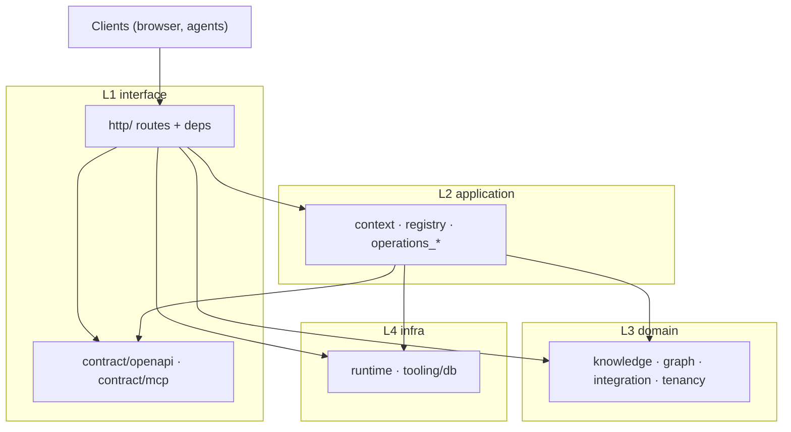

# Basis Python package layout

Physical layout for the `basis` installable package (repo `basis/`). Integration contract: [openapi-v1.md](openapi-v1.md).

Pre-layered import prefixes (`basis.api`, `basis.core`, `basis.control`, `basis.runtime`, `basis.tooling`, …) are blocked by `scripts/audit-legacy-package-imports.py`.

## Architectural layers

| Layer | Path | Core capabilities |
| --- | --- | --- |
| **L1 Interface** | `basis/interface/` | HTTP, MCP wire protocol, OpenAPI/MCP contract (`contract/`) |
| **L2 Application** | `basis/application/` | `KbCoreContext`, operation registry, use-case handlers, DTOs |
| **L3 Domain** | `basis/domain/` | Product + platform business rules (four subdomains below) |
| **L4 Infra** | `basis/infra/` | Config, DB pool, limits, observability, SQL migrations, test DB helpers |

Entry: `basis/cli.py` → Uvicorn `basis.interface.http.app:create_app`.

### L3 Domain subdomains

| Subdomain | Path | Capabilities |
| --- | --- | --- |
| **Knowledge** | `domain/knowledge/` | Evidence ledger (canonical SQL), ingest `pipeline/`, review, search, connector ledger sync, schedulers |
| **Graph** | `domain/graph/` | `projection/` (ContextGraph), `explorer/` (Explorer HTTP domain) |
| **Integration** | `domain/integration/` | BOCP engine: manifests, runtime, adapters, vault, `providers/` bundles |
| **Tenancy** | `domain/tenancy/` | AdminStore, org/users, SSO/OIDC/SAML, model catalog, realtime |

Shared domain errors: `basis/domain/errors.py` (`AdminError`; tenancy re-exports for compatibility).

### Dependency rules

1. **Domain** must not import `basis.interface` or `basis.application`.
2. **Application** may import domain + infra (+ `interface.contract.mcp` for result formatting); must not import `interface.http`.
3. **Interface** may import application, domain, infra.
4. **Knowledge** should not import graph / integration / tenancy; **tenancy** may call **knowledge** for purge/roles; **graph** and **integration** may call **knowledge**.

CI: [import-linter](https://import-linter.readthedocs.io/) (`importlinter.ini`).

Solid arrows are **allowed** import/call direction at runtime. Domain must not depend on L1/L2 (enforced by `importlinter.ini` + `audit-legacy-package-imports.py`).

### Shared operation dispatch (HTTP + MCP)

| Step | Location | Role |
| --- | --- | --- |
| 1 | `interface/http/kb_core_context.py` | `build_kb_core_context` — KB, `KnowledgeStore`, graph runtime loader, blob/projection bindings |
| 2 | `interface/http/platform_mcp.py`, KB MCP routes | JSON-RPC → `application.registry.execute` / `run` |
| 3 | `application/operations_catalog.py` | Static operation name → handler (`operations.py`, `operations_connectors.py`) |
| 4 | `application/registry.py` | Validate args (`models.py`), dispatch, MCP `tools/list` (+ connector tools when `ctx` set) |
| 5 | `interface/contract/mcp/openapi.py` | Derive MCP `inputSchema` from live OpenAPI where possible |

Many REST handlers call **domain** services directly; graph/review/MCP core tools go through **application** so HTTP and MCP share one registry. Normative surface: [openapi-v1.md](openapi-v1.md).

### CI layout guards

Run in `.github/workflows/ci.yml` (`pytest` job, before full `pytest`):

| Check | Command |
| --- | --- |
| Layer import contracts | `uv run lint-imports --config importlinter.ini` |
| Explorer legacy imports | `audit-semantica-explorer-{imports,session-imports,package-imports}.py` |
| Explorer / platform shims | `audit-explorer-shim-imports.py`, `audit-compat-shim-imports.py` |
| Deprecated `basis.*` prefixes | `audit-legacy-package-imports.py` |
| KB HTTP aggregators | `audit-kb-http-aggregators.py` |

OpenAPI job (same workflow): `generate-openapi-v1.py`, `audit-web-openapi-paths.mjs`, `audit-web-operation-ids.py`, TS schema drift.

## Package tree (quick reference)

| Path | Layer |
| --- | --- |
| `basis/interface/http/`, `interface/mcp/`, `interface/contract/` | L1 |
| `basis/application/` | L2 |
| `basis/domain/knowledge/`, `graph/`, `integration/`, `tenancy/` | L3 |
| `basis/infra/runtime/`, `infra/tooling/` | L4 |

HTTP handlers live as flat modules under `interface/http/` (e.g. `kb_connectors_oauth.py`). URLs unchanged ([KB aggregators](#kb-http-surface)).

### `basis/interface` layout

| Location | Purpose |
| --- | --- |
| `http/` | FastAPI app, deps, `mount_v1`, flat `kb_*` / `platform_*` routes |
| `mcp/` | JSON-RPC protocol (`protocol.py`, `tools.py`); KB route in `http/platform_mcp.py` |
| `contract/openapi/` | Live OpenAPI export (`v1_export.py`), CI `spec.py` |
| `contract/mcp/` | MCP `inputSchema` from OpenAPI, connector tool defs, `format.py` |

### `basis/application` layout

| Location | Purpose |
| --- | --- |
| `context.py`, `registry.py`, `operations_catalog.py`, `operations.py` | `KbCoreContext`, MCP/HTTP-shared operation dispatch |
| `operations_connectors.py`, `review_deps.py`, `governance_hooks.py` | Connector + review operation helpers |
| `operation_http.py`, `models.py`, `errors.py` | Operation HTTP response helpers and shared DTOs |

#### Module wiring

| Module | Imports | Called from |
| --- | --- | --- |
| `context.py` | domain stores, graph runtime types | `interface/http/kb_core_context.py`, MCP protocol |
| `registry.py` | `operations_catalog`, `contract/mcp/*`, `models` | `interface/mcp/*`, `platform_mcp.py`, ledger/graph/review HTTP routes |
| `operations_catalog.py` | `operations`, `operations_connectors` | `registry` only (single catalog) |
| `operations.py` | domain knowledge/graph; `review_deps`, `governance_hooks` | Catalog handlers for KB search/graph/review |
| `operations_connectors.py` | domain integration + knowledge connector services | Catalog + dynamic `connector_*` MCP tools |
| `review_deps.py` | `ReviewApproveDeps` from context fields | `operations` approve/reject paths |
| `governance_hooks.py` | Explorer governance decision recorder | `operations` where graph governance is logged |
| `operation_http.py` | maps `{error: …}` payloads to `HTTPException` | KB routes that call `registry.run` |

#### Static operations (`OPERATIONS` in `operations_catalog.py`)

| Group | Tool names | Handler module |
| --- | --- | --- |
| KB summary & RAG | `describe_kb`, `search_chunks`, `get_chunk` | `operations.py` |
| Graph & entities | `find_entities`, `neighbors`, `paths`, `entity_facts`, `graph_search` | `operations.py` |
| Remember & review | `propose_remember`, `list_review_items`, `get_review_item`, `approve_statement_remember_review`, `reject_statement_remember_review`, `approve_review_item`, `reject_review_item` | `operations.py` |
| Processing | `list_processing_jobs` (`mcp: false` — HTTP/OpenAPI only) | `operations.py` |
| Connectors | `list_connector_catalog`, `describe_connector_service`, `list_connector_connections`, `list_connector_table_mappings`, `sync_connector_table_mapping`, `invoke_connector_primitive`, `execute_connector_tool`, `propose_entity_writeback` | `operations_connectors.py` |

Manifest-expanded MCP tools (`connector_{service}__…`) resolve to `invoke_connector_primitive` in `registry.py` via `interface/contract/mcp/connector_tools.py`. Full HTTP↔tool map: [openapi-v1.md §6](openapi-v1.md).

## Knowledge (`domain/knowledge`)

KB canonical SQL lives in `domain/knowledge/sql_*.py` modules (caller often holds `KnowledgeStore._lock`; use raw `conn` inside an existing lock block). Shared connector SQL types: `domain/knowledge/sql.py`. `KnowledgeStore` (`store.py`) delegates to `domain/knowledge/access/*`. Row DTOs: `ledger_rows.py`. Ingest pipeline: `domain/knowledge/pipeline/`.

| Location | Purpose |
| --- | --- |
| `store.py` | `KnowledgeStore` façade |
| `sql_*.py` | Canonical ledger SQL (one module per topic, e.g. `sql_documents`, `sql_connector_sync`) |
| `access/` | Lock + validation per slice |
| `services/` | Governor, review, connector_sync, remember, … |
| `schedulers/` | Poll ticks + due predicates |
| `search/` | Chunk search, embeddings |
| `pipeline/` | Document ingest / version ingest |

## Graph (`domain/graph`)

| Package | Role |
| --- | --- |
| `projection/` | `GraphSession`, snapshot JSON, projector, legacy ontology session |
| `explorer/` | Explorer adapters — see [explorer README](../../basis/domain/graph/explorer/README.md) |

**Imports:** `basis.domain.graph.explorer.<subpackage>.<module>` only. CI: `scripts/audit-explorer-shim-imports.py`.

## Integration vs knowledge (BOCP)

| Concern | Path |
| --- | --- |
| Engine | `domain/integration/` — no canonical connector table SQL |
| Ledger sync | `domain/knowledge/services/connector_sync.py` + `sql_connector_*.py` |
| Bridge | `domain/integration/canonical_db.py` (`LockedCanonicalConn`) |

HTTP/MCP: `interface/http/...` + `application/operations_connectors.py` compose engine + `KnowledgeStore`.

## KB HTTP surface

Aggregators: `kb_connectors.py`, `kb_documents.py`, `kb_explorer.py`, … — each `include_router` from sibling `kb_*` / `kb_*_*` modules. Former path map:

| Aggregator | Sub-routers |
| --- | --- |
| `workspace/` | `{kbs,tokens}` |
| `graph/` | `{read,search,models}` |
| `documents/` | `{crud,jobs,ontology,models,processing_support}` |
| `explorer/` | `{sparql,semantic,decisions,reasoning,graph_io,temporal,staging,governance,shared}` |
| `ontology/` | `{vocabulary,alignments,session}` + `hub/` |
| `review/` | `{models,queue,audit}`; `resolve` → `{approve,reject}` |
| `connectors/` | `{catalog,connections,mappings,outbox,oauth,tools,models,support}` |
| `ledger/` | `{read,remember,mutations,models}` |
| `sources/` | `{crud,ingest,models,support}` |
| `config/` | `{mappings,alerts,governance,reasoning_rules}` |

Platform auth: `platform_auth.py` aggregates `platform_auth_session.py`, `platform_auth_saml.py`, …

## Tenancy admin store

Canonical admin SQL: `domain/tenancy/admin/persistence/`. `AdminStore` façade: `domain/tenancy/admin/store.py`, delegates `admin/access/*`.

## Infra

- SQL migrations: `infra/tooling/db/migrations/`
- Alembic: repo-root `alembic.ini` → `basis/infra/tooling/db/alembic`
- Package data: `pyproject.toml` → `basis.infra.tooling.db`, `basis.domain.integration`

## Migration from v2 layout

| v2 | v3 (layered) |
| --- | --- |
| `basis.api` | `basis.interface` (via `basis.delivery` interim) |
| `basis.delivery` | `basis.interface` |
| `basis.interfaces` | `basis.interface` |
| `basis.application.openapi` | `basis.interface.contract.openapi` |
| `basis.application.mcp` | `basis.interface.contract.mcp` |
| `basis.core.ledger` | `basis.domain.knowledge` |
| `basis.core.pipeline` | `basis.domain.knowledge.pipeline` |
| `basis.core.projection` | `basis.domain.graph.projection` |
| `basis.core.explorer` | `basis.domain.graph.explorer` |
| `basis.core.connectors` | `basis.domain.integration` |
| `basis.core.errors` | `basis.domain.errors` |
| `basis.control` | `basis.domain.tenancy` |
| `basis.runtime` | `basis.infra.runtime` |
| `basis.tooling` | `basis.infra.tooling` |
| `basis.infrastructure` | `basis.infra` |

Rewrite scripts: `migrate_package_layout_v3_layers.py`, `flatten_delivery_http_v3.py`, `flatten_knowledge_sql_v3.py`, `migrate_interfaces_v4.py`, `migrate_interface_singular_v5.py`, `migrate_infra_v6.py`.
