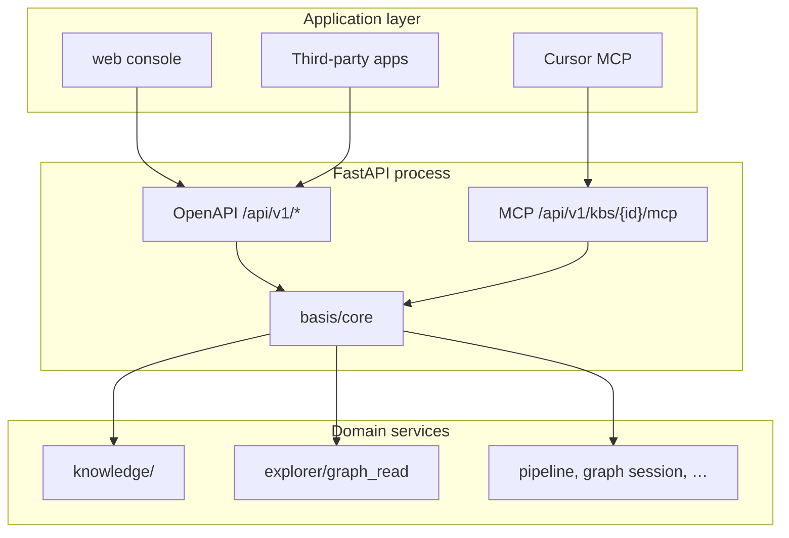

# Core, REST v1, and client SDK refactor

## Status

- **Decision:** proposed (2026-03)
- **Scope:** normative **OpenAPI v1** (complete HTTP contract), **`basis/core`**, **MCP** adapter, **application-layer** client SDK
- **First priority:** [openapi-v1-spec.md](openapi-v1-spec.md) + [`openapi/basis-v1.yaml`](../../openapi/basis-v1.yaml) — **spec complete before route refactors**
- **Server product surfaces:** **only OpenAPI (HTTP)** and **MCP** — no separate “console backend”
- **Maps to:** F-OPS-06, F-CHAT-05, M7-08 in [implementation-backlog.md](implementation-backlog.md)
- **Reference model:** [Supabase](https://supabase.com/docs/guides/getting-started/architecture) — Dashboard is an OpenAPI client like any other app

## 1. Problem

Today Basis exposes integration capabilities through overlapping paths:

| Path | Role today |
| --- | --- |
| `GET/POST /api/kbs/{kb_id}/mcp` | JSON-RPC MCP; business logic in `basis/mcp/tools.py` |
| `basis/chat/playground.py` | Reuses `call_tool` from `mcp/tools.py` |
| `/api/kbs/...` (many routers) | Console, ingest, Explorer, search — hand-overlapping with MCP |
| `GET /openapi.json` | **Full** FastAPI schema (internal + public mixed) |
| `web/src/lib/api.ts` | Hand-written `fetch('/api/...')` — not an SDK, not tied to a stable OpenAPI subset |

Gaps:

1. No **single server core** for “agent integration” operations (search chunks, graph read, remember, …).
2. No **versioned, stable REST** that matches MCP tools one-to-one.
3. No **application SDK** (`@basis/client`) generated from that REST spec.
4. Naming confusion: “SDK” in product docs (OSDK-lite) vs **semantica** (runtime library) vs **MCP tools**.

## 2. Goals and non-goals

### Goals

1. **Complete OpenAPI v1** — every console and integration HTTP call documented in [`openapi/basis-v1.yaml`](../../openapi/basis-v1.yaml); served at `GET /openapi/v1.json`.
2. **`basis/core/`** — implements operations defined in the spec; **HTTP and MCP call only core**.
3. **Two server surfaces:** OpenAPI + MCP (same process is fine; not a third API for the web app).
4. **`packages/client`** — generated/typed from OpenAPI; **`web/`** migrates to it (no permanent shadow `/api/*` only the console knows).
5. **MCP** — tool schemas derived from the same operations as OpenAPI (subset or 1:1 where appropriate).

### Non-goals (this program)

- Auto-generating REST from SQL (PostgREST-style); operations stay **explicit** in core + YAML.
- Platform-wide single MCP URL for all KBs — optional later.
- Publishing npm/PyPI before monorepo `packages/client` dogfoods the spec.

## 3. Terminology

| Term | Meaning |
| --- | --- |
| **core** | Python package `basis/core/` — integration operations, Pydantic I/O, auth checks |
| **OpenAPI v1** | Normative YAML + `/api/v1/*` HTTP routes implementing `basis/core` |
| **Basis client SDK** | TS (primary) / Py clients generated from OpenAPI — **web included** |
| **semantica** | Third-party runtime used **inside** the API process — not the public integration SDK |
| **MCP adapter** | `basis/mcp/` — JSON-RPC transport → `core.execute()` |

## 4. Target architecture



**Supabase analogy**

| Supabase | Basis target |
| --- | --- |
| PostgREST + project REST | **`/api/v1` OpenAPI** (full product HTTP) |
| `supabase-js` | `@basis/client` |
| Dashboard | `web/` — **only** OpenAPI (+ WS/SSE as documented) |
| GoTrue | Auth paths in same OpenAPI |
| Realtime | WS/SSE extensions in same spec |

## 5. Repository layout (target)

```text
basis/
  core/
    __init__.py
    context.py          # KbCoreContext (from today's KbToolContext)
    registry.py         # operation metadata + JSON Schema for MCP
    execute.py          # dispatch(name, payload) -> result | CoreError
    errors.py           # stable error codes for REST + MCP
    operations/
      kb.py             # describe_kb
      chunks.py         # search_chunks, get_chunk
      entities.py       # find_entities, entity_facts
      graph.py          # neighbors, paths (+ search_graph later)
      remember.py       # propose_remember
  mcp/
    protocol.py         # JSON-RPC only
    # tools.py removed or thin wrapper importing core
  api/routes/
    v1/                 # HTTP handlers match openapi/basis-v1.yaml
    mcp.py              # JSON-RPC → core
    # legacy /api/* removed after cutover

packages/
  client/               # @basis/client — createBasisClient(url, { accessToken })
  # optional: client-auth, client-realtime

scripts/
  gen-client-types.ts   # openapi-typescript from openapi/basis-v1.yaml
```

## 6. API conventions

See **[openapi-v1-spec.md](openapi-v1-spec.md)** for normative rules. Summary:

### 6.1 URL shape

- **Single tree:** `/api/v1/...` (see YAML `servers`).
- Prefer **resource-oriented** paths (`GET .../chunks/{id}`) over RPC where CRUD fits; use `POST .../graph/paths` for complex graph queries.
- MCP tool arguments must equal the OpenAPI request schema for the linked operation.

### 6.2 OpenAPI artifact

- **Source of truth:** [`openapi/basis-v1.yaml`](../../openapi/basis-v1.yaml)
- **Served:** `GET /openapi/v1.json` (CI must match YAML).
- **Legacy:** today’s unversioned `/api/*` and auto `/openapi.json` are **deprecated** once v1 GA.

MCP `tools/list` schemas **generated from the same components** as the YAML (via `core.registry` fed from spec).

### 6.3 Auth and scopes

- Same as today: `Authorization: Bearer` (session JWT or API token).
- KB access: existing `get_kb_for_viewer` / `get_kb_for_editor` inside core or context factory.
- **Phase 1:** reuse token `scope` (`read` / future `write`) — `propose_remember` requires editor.
- **Phase 2 (M7-08):** explicit `integration:read` / `integration:write` if needed.

### 6.4 Operations in v1 (initial set)

Match current MCP (`basis/mcp/tools.py`):

| Operation | MCP today | REST v1 | Notes |
| --- | --- | --- | --- |
| `describe_kb` | yes | yes | |
| `search_chunks` | yes | yes | filters in schema even if web UI omits them |
| `get_chunk` | yes | yes | |
| `find_entities` | yes | yes | ledger + graph nodes |
| `neighbors` | yes | yes | requires graph runtime |
| `paths` | yes | yes | |
| `entity_facts` | yes | yes | |
| `propose_remember` | yes | yes | editor only |

**Later v1 additions (explicit backlog):** `search_graph` (parity with `POST .../graph/search`, optional `at`), `get_node`, paginated edges — only after schema design in core.

## 7. Client SDK shape (TypeScript)

```ts
import { createBasisClient } from '@basis/client'

const basis = createBasisClient(process.env.BASIS_URL!, {
  accessToken: token,
})

const { data, error } = await basis
  .kb(kbId)
  .rpc('search_chunks', { query: 'evidence', limit: 10 })
```

Implementation:

- Thin `fetch` wrapper (request ID header, Bearer, JSON).
- `kb(kbId).rpc(name, args)` → `POST /rest/v1/kbs/{kbId}/rpc/{name}`.
- Types from OpenAPI codegen in CI or `npm run gen:client`.

Python client optional in R5+ (`basis-client` on PyPI or `packages/client-py/`).

## 8. Web console migration

| Phase | Console behavior |
| --- | --- |
| Now | `web/src/lib/api.ts` → legacy `/api/*` |
| After v1 GA | **All** fetches via `@basis/client` + OpenAPI types |
| Explorer | Client module covers documented WS/SSE where OpenAPI extensions define them |

**End state:** no console-only HTTP surface; web is the first-party OpenAPI client.

## 9. MCP

- Keep per-KB URL: `/api/kbs/{kb_id}/mcp`.
- `tools/call` → validate args with core Pydantic models → `core.execute`.
- MCP result text JSON remains for backward compatibility; document equivalence to REST `data` field.

## 10. Implementation plan

**Critical path:** complete OpenAPI **before** large core extractions.

### S0 — Complete OpenAPI v1 spec (≈ 2–4 weeks, ongoing)

| Task | Output |
| --- | --- |
| Follow [openapi-v1-spec.md](openapi-v1-spec.md) §4–§6 | All tags checked in inventory |
| Fill [`openapi/basis-v1.yaml`](../../openapi/basis-v1.yaml) | ~150 operations, shared `components.schemas` |
| Web call-site audit | Every `api()` path maps to `operationId` |
| MCP ↔ operation mapping | §5 of openapi-v1-spec locked |
| CI: Spectral + YAML ↔ served JSON | Gate on PR |

**Acceptance:** reviewers sign off YAML; **no “TBD path”** for console-critical flows (auth, KB list, sources, search, graph read, review, chat).

---

### R0 — Architecture lock (≈ 0.5 week)

| Task | Output |
| --- | --- |
| Approve this doc + OpenAPI-first ordering | ADR or status → accepted |
| AGENTS.md / README pointer | Linked |

**Acceptance:** S0 can proceed in parallel; R0 unblocks R1 after S0 ≥ MVP slice (auth + KB + search + MCP ops).

---

### R1 — Extract core (≈ 1–2 weeks)

| Task | Details |
| --- | --- |
| Create `basis/core/` with `context`, `execute`, `operations/*` | Move logic from `basis/mcp/tools.py` |
| Pydantic models per operation | Request/response types |
| `core.registry` | Names, descriptions, JSON Schema |
| Refactor `basis/mcp/tools.py` | Re-export or delegate to `core.execute` |
| Refactor `basis/chat/playground.py` | Import from `core` only |
| Tests | `tests/test_core_operations.py`; keep `tests/test_mcp.py` green |

**Acceptance:** MCP + chat behavior unchanged; pytest `-q` pass.

---

### R2 — Implement `/api/v1` to match YAML (≈ 2–3 weeks, incremental by tag)

| Task | Details |
| --- | --- |
| `basis/api/routes/v1/*` | Handlers call `core` only |
| Serve `GET /openapi/v1.json` from YAML | Single served document |
| Deprecation headers on legacy `/api/*` | `Sunset` / docs |
| Contract tests | Schemathesis or openapi-driven pytest |

**Acceptance:** MVP tag set in S0 passes contract tests.

---

### R3 — MCP from spec (≈ 0.5 week)

| Task | Details |
| --- | --- |
| `TOOL_DEFINITIONS` from OpenAPI/core registry | No drift |
| MCP POST path aligned to v1 | e.g. `/api/v1/kbs/{kb_id}/mcp` |

**Acceptance:** MCP tools match YAML-linked operations.

---

### R4 — Client package + codegen (≈ 1 week)

| Task | Details |
| --- | --- |
| `packages/client` with `createBasisClient`, `kb().rpc()` | Minimal deps |
| `scripts/gen-client-types.ts` | openapi-typescript |
| Wire into `web` for **one** feature | e.g. MCP panel “test call” or search chunks |
| Document in README | Env `BASIS_API_URL` |

**Acceptance:** `npm run typecheck` in web; client unit test with mocked fetch.

---

### R5 — Hardening (≈ 1 week, parallelizable)

| Task | Details |
| --- | --- |
| Rate limits | Reuse or extend MCP semaphore for REST v1 |
| Error code table | Sync with `web/src/i18n/locales/*/apiErrorCodes.ts` |
| Optional Python client | Thin httpx wrapper |
| nginx / docker | Proxy `/rest/v1/openapi.json` like `/openapi.json` |

**Acceptance:** `mcp_busy`-style behavior documented for REST; e2e smoke optional.

---

### R6 — Legacy `/api/*` removal (after web cutover)

| Task | Details |
| --- | --- |
| Delete unversioned routers | Only `/api/v1` + MCP remain |
| nginx / docs | Single OpenAPI URL |

**Acceptance:** `web/` has zero legacy path strings; pytest + e2e green.

---

## 11. Dependencies and ordering

```text
S0 (OpenAPI YAML complete) ──► R1 (core) ──► R2 (implement v1) ──► R3 (MCP sync)
                                      └──────────────► R4 (client) ──► R6 (drop legacy)
R5 hardening parallel to R2+
R0 governance anytime
```

Blockers:

- **R1/R2 must not invent paths** — only implement what S0 YAML defines.
- R4 requires S0 schemas stable enough to codegen.

## 12. Risks

| Risk | Mitigation |
| --- | --- |
| Spec–code drift | CI: YAML = served JSON; contract tests |
| Large S0 effort (~150 routes) | Tag-by-tag MVP; checklist in openapi-v1-spec §4 |
| Explorer runtime missing → graph ops fail | Document in OpenAPI responses; `describe_kb` capabilities |
| Breaking v1 | `/api/v2` + new YAML; freeze v1 |

## 13. Success metrics

1. **`openapi/basis-v1.yaml` is complete** and powers `GET /openapi/v1.json`.
2. **Web + MCP + third parties** use the same operation definitions via core.
3. Zero business logic in route handlers or `mcp/tools.py` outside `basis/core`.
4. New HTTP behavior **starts in YAML**, then core, then handlers.

## 14. Related documents

- **[openapi-v1-spec.md](openapi-v1-spec.md)** — spec-first program ( **start here** )
- [product-and-roadmap.md](product-and-roadmap.md) — F-OPS-06, F-CHAT-05
- [implementation-backlog.md](implementation-backlog.md) — M7-08 Integration surface
- [capability-gap-checklist.md](capability-gap-checklist.md) — MCP / OSDK status
- [search-storage-architecture.md](search-storage-architecture.md) — chunk search semantics for `search_chunks`
